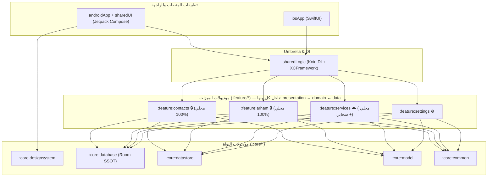
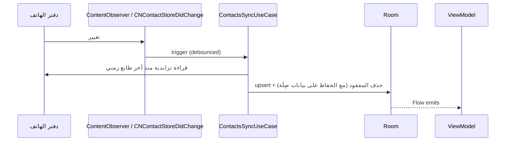
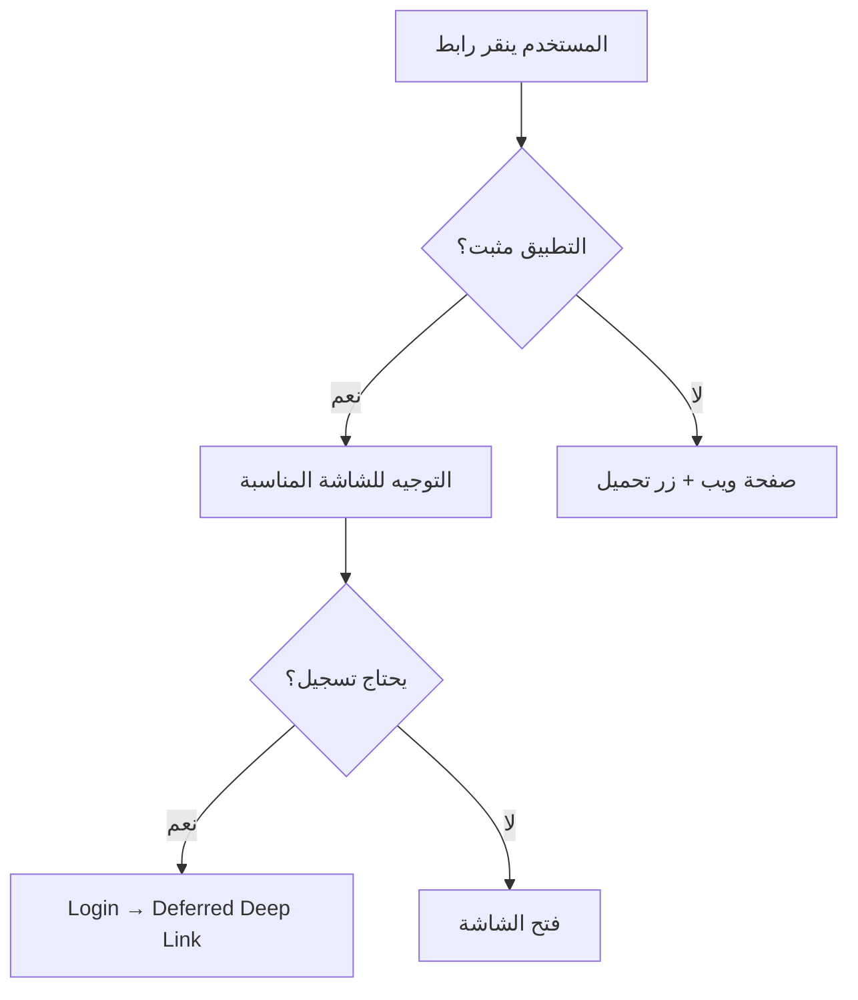

# المعمارية (Architecture)

> المرجع: [PRD §14](PRD.md#14-المعمارية-التقنية) · القرارات: [adr/](adr/)

## 1. المبادئ
| المبدأ | التطبيق في صِلَة |
|---|---|
| **Clean Architecture** | `presentation → domain ← data`؛ الـ domain نقي بلا أي إطار عمل |
| **SOLID** | واجهة لكل Repository/Source، UseCase بمسؤولية واحدة، الحقن عبر Koin |
| **MVVM + UDF** | `UiState` (StateFlow) + `Intent` + `UiEffect` (Channel) |
| **Offline-First / SSOT** | Room هو المصدر الوحيد للواجهة |
| **KMP + Native UI** | المنطق و ViewModels في `shared/`، الواجهة Compose/SwiftUI |
| **Privacy by Architecture** | قيود اعتماديات بين الموديولات تُفرض في البناء |

## 2. الطبقات واستراتيجية التقسيم الهجين (Layers inside Features)

> المرجع التفصيلي: [ADR-0007](adr/0007-hybrid-feature-modularization.md)

يعتمد مشروع **صِلَة** على **النهج الهجين: الطبقات داخل الميزات (Layers inside Features — Vertical Slice Architecture)**:
- **على المستوى الخارجي (Gradle Modules):** يُقسم المشروع إلى موديولات نُواة (`:core:*`) وموديولات ميزات مستقلة (`:feature:*`).
- **على المستوى الداخلي (داخل كل `:feature:*`):** يُقسم الكود إلى طبقات Clean Architecture الثلاث (`domain` · `data` · `presentation`).



**قواعد الاعتماد:**
- كل `:feature:*` مكتفٍ ذاتياً ويحتوي داخلياً على حزم `domain` و `data` و `presentation`.
- **يُمنع منعاً باتاً** أن يعتمد `:feature:x` على `:feature:y` مباشرة؛ التشارك يتم عبر `:core:model` و `:core:database` (SSOT).
- داخل الميزة الواحدة: `presentation` يعتمد على `domain` فقط، و `data` ينفذ عقود `domain`.
- الواجهات الأصلية تعتمد على `:sharedLogic` (Umbrella) و `:core:designsystem`.

## 3. هيكل الموديولات والحزم

```text
ContactsSila/
├── core/
│   ├── common/            AppResult, DataError, AppDispatchers, AppClock,
│   │                      PhoneNormalizer, ArabicTextNormalizer, Redactor, MviViewModel
│   ├── model/             Contact, Category, Service, ArhamItem, UserPreferences, 18 Enums
│   ├── database/          Room KMP Entities, DAOs (ContactDao, ArhamDao, ServiceDao, CleanupDao)
│   ├── datastore/         UserPreferencesDataSource
│   └── designsystem/      SilaTheme, SilaColors, SilaTypography, SilaActionSheet, Chips, Rows
│
├── feature/               (النهج الهجين: الطبقات كموديولات Gradle فرعية داخل كل ميزة)
│   ├── contacts/          🔒 محلي 100% — بلا أي تبعية للشبكة
│   │   ├── domain/        (:feature:contacts:domain)
│   │   ├── data/          (:feature:contacts:data)
│   │   └── presentation/  (:feature:contacts:presentation)
│   ├── arham/             🔒 محلي 100% — بلا أي تبعية للشبكة
│   │   ├── domain/        (:feature:arham:domain)
│   │   ├── data/          (:feature:arham:data)
│   │   └── presentation/  (:feature:arham:presentation)
│   ├── services/          ☁️ الدليل السحابي الحي
│   │   ├── domain/        (:feature:services:domain)
│   │   ├── data/          (:feature:services:data)
│   │   └── presentation/  (:feature:services:presentation)
│   └── settings/          ⚙️ التفضيلات والإعدادات
│       ├── domain/        (:feature:settings:domain)
│       ├── data/          (:feature:settings:data)
│       └── presentation/  (:feature:settings:presentation)
│
├── sharedLogic/           Umbrella Module: تجميع الميزات + initKoin() + تصدير SharedLogic.framework لـ iOS
├── sharedUI/              شاشات Compose المشتركة + موارد الترجمة (values / values-en)
├── androidApp/            تطبيق الأندرويد (MainActivity + AndroidManifest + ProGuard)
└── iosApp/                تطبيق الآيفون (SwiftUI + Localizable.strings)
```

### مصفوفة الاعتمادات الممنوعة (تُفرض على مستوى Gradle واختبارات المعمارية)

| الموديول / الطبقة | ممنوع الاعتماد على |
|---|---|
| `:feature:contacts` | `:core:network`, `:core:firebase`, أو أي `:feature:*` آخر |
| `:feature:arham` | `:core:network`, `:core:firebase`, أو أي `:feature:*` آخر |
| `:feature:*` | أي `:feature:*` شقيق (التواصل عبر `:core:database` و `:core:model` فقط) |
| حزمة `*.domain` داخل أي ميزة | حزمة `*.data` أو `*.presentation` أو تفاصيل الشبكة/الأطر الخارجية |

## 4. نمط الـ ViewModel

```kotlin
interface MviViewModel<S, I, E> {
    val state: StateFlow<S>
    val effects: Flow<E>          // Navigation, Toast, OpenDialer…
    fun onIntent(intent: I)
}

class ArhamViewModel(
    private val getPriorityList: GetArhamPriorityListUseCase,
    private val getStats: GetArhamDashboardStatsUseCase,
    private val syncCalls: SyncCallLogUseCase,
) : ViewModel(), MviViewModel<ArhamUiState, ArhamIntent, ArhamEffect> {

    private val period = MutableStateFlow(Period.WEEK)
    private val _effects = Channel<ArhamEffect>(Channel.BUFFERED)
    override val effects = _effects.receiveAsFlow()

    override val state = period.flatMapLatest { p ->
        combine(getPriorityList(), getStats(p)) { list, stats ->
            ArhamUiState(isLoading = false, period = p, stats = stats, items = list)
        }
    }.stateIn(viewModelScope, SharingStarted.WhileSubscribed(5_000), ArhamUiState())

    override fun onIntent(intent: ArhamIntent) = when (intent) {
        is ArhamIntent.ChangePeriod -> period.value = intent.period
        is ArhamIntent.Call -> { viewModelScope.launch { _effects.send(ArhamEffect.Dial(intent.phone)) }; Unit }
        ArhamIntent.Refresh -> { viewModelScope.launch { syncCalls() }; Unit }
    }
}
```

**على iOS:** يُستخدم SKIE لتحويل `StateFlow` إلى `AsyncSequence`، ويُغلف الـ ViewModel في `@Observable` wrapper صغير في Swift.

## 5. Repository (Offline-First)

```kotlin
class ServicesRepositoryImpl(
    private val dao: ServiceDao,
    private val remote: ServicesRemoteSource,   // Firestore/Ktor
) : ServicesRepository {
    override fun observeDirectory(filter: DirectoryFilter): Flow<PagingData<Service>> =
        Pager(PagingConfig(pageSize = 30)) { dao.pagingSource(filter.toQuery()) }
            .flow.map { it.map(ServiceEntity::toDomain) }

    override suspend fun refresh(filter: DirectoryFilter): Result<Unit> = runCatching {
        val remoteItems = remote.fetch(filter)
        dao.upsertAll(remoteItems.map { it.toEntity() })
    }
}
```

### 5.1 استراتيجية الـ Pagination (Cursor-based)
> [!NOTE]
> Firestore لا يدعم Offset — نستخدم **Cursor-based pagination** مع `startAfter`.

```kotlin
// Remote: Firestore Cursor-based
suspend fun fetchPage(filter: DirectoryFilter, lastDoc: DocumentSnapshot?): Pair<List<ServiceDto>, DocumentSnapshot?> {
    var query = firestore.collection("services")
        .whereEqualTo("professionId", filter.professionId)
        .orderBy("trustScore", Query.Direction.DESCENDING)
        .limit(30)
    lastDoc?.let { query = query.startAfter(it) }
    val snapshot = query.get().await()
    return snapshot.documents.map { it.toDto() } to snapshot.documents.lastOrNull()
}

// Local: Room PagingSource (for UI)
@Query("SELECT * FROM services WHERE professionId = :profId ORDER BY trustScore DESC")
fun pagingSource(profId: String): PagingSource<Int, ServiceEntity>
```

**التدفق:**
1. الواجهة تقرأ من Room عبر `PagingSource` (Offset-based محلياً — Room يدعمه).
2. `RemoteMediator` يجلب الصفحة التالية من Firestore (Cursor-based) ويكتبها في Room.
3. Room يُشعر الواجهة تلقائياً عبر `PagingData` Flow.

## 6. مزامنة دفتر الهاتف



> [!NOTE]
> المخطط أعلاه يصف التصميم السابق. التسلسل المعتمد في المرحلة 1 هو [ADR-0010](adr/0010-incremental-contacts-sync.md):
> Android = `ContentObserver` مجمّع (إشارة فقط) + فرق `RawContacts.VERSION` + مصالحة كاملة دورية؛ iOS = `CNChangeHistoryFetchRequest` + رمز محفوظ، وإعادة مزامنة كاملة عند فقدانه.
> والحذف **ليس فورياً**: تعليم `systemDeletedAt` أولاً ثم تنظيف بعد 30 يوماً.

- الربط بين السجل المحلي وجهة الاتصال الأصلية: `systemContactId` (أندرويد: `LOOKUP_KEY` · iOS: `identifier`) مع `lookupKey` كمرآة أندرويد — [ADR-0009](adr/0009-contacts-platform-boundary.md).
- بيانات صِلَة (التصنيف، أرحام، الوسوم) تُحفظ في Room فقط، ولا تُكتب في دفتر الهاتف (باستثناء النغمة والبريد الصوتي والمفضلة والحقول القياسية).

## 7. المهام الخلفية

| المهمة | أندرويد | iOS | التكرار |
|---|---|---|---|
| مزامنة أحداث المكالمات لأرحام ([ADR-0006](adr/0006-call-log-strategy.md) مقبول — B+؛ لا سجل مكالمات ولا `READ_CALL_LOG`) | `CallEventSyncWorker`: `IN_APP` + `ANDROID_CALL_SCREENING` الاختياري + `ANDROID_TELEPHONY_OBSERVER` (حالة فقط، بلا رقم) | `IN_APP` + `IOS_CALL_OBSERVER` أثناء حياة التطبيق (بلا هوية) | عند المكالمة + تأكيد/تسجيل يدوي |
| حساب تنبيهات أرحام | `ArhamReminderWorker` | `BGAppRefreshTask` + إشعارات مجدولة مسبقاً | يومياً في الوقت المفضل |
| فحص المكررات | `DuplicateScanWorker` | `BGProcessingTask` | أسبوعياً |
| الفلترة الذكية | `SmartCategorizeWorker` | `BGProcessingTask` | بعد Onboarding + عند إضافة دفعة أسماء |
| مزامنة الخدمات | `ServicesSyncWorker` (يُطلق من FCM) | Silent push + `BGAppRefreshTask` | عند الإشعار + يومياً |
| تطبيق نغمة التصنيف | `ApplyCategoryRingtoneWorker` | — | عند التغيير |
| تنظيف البيانات المنتهية | `DataCleanupWorker` | `BGProcessingTask` | يومياً (call_events, inbox) + أسبوعياً (disputes, sessions) |
| أتمتة أرحام | `ArhamAutomationWorker` | `BGAppRefreshTask` | حسب الجدول (كل 15 دقيقة فحص) |

> على iOS: لأن المهام الخلفية غير مضمونة التوقيت، تُجدول إشعارات أرحام **مسبقاً** عبر `UNCalendarNotificationTrigger` عند كل فتح للتطبيق.

## 8. التنقل

```text
Root
├── Onboarding (graph)
└── Main (Bottom Nav — 3 tabs, back stack مستقل لكل تبويب)
    ├── Contacts → ContactDetails(id) → EditContact(id?) · Duplicates · SmartCategorizeReview · QrScanner
    ├── Services → ServiceDetails(id) · AddBusinessCard · Auth
    └── Arham    → KinshipSetup(contactId) · FamilyTree
Settings (من شريط علوي)
Deep links: sila://contact/{id} · https://sila.app/s/{serviceId} · https://sila.app/p/{cardId}
```

### 8.1 Deep Links & App Links — التفاصيل

| الرابط | الوجهة | سلوك بدون التطبيق |
|---|---|---|
| `sila://contact/{id}` | صفحة تفاصيل جهة الاتصال | لا يعمل (scheme خاص) |
| `https://sila.app/s/{serviceId}` | صفحة الخدمة في الدليل | يُفتح موقع ويب بسيط مع زر تحميل |
| `https://sila.app/p/{cardId}` | البطاقة التعريفية + QR | يُفتح موقع ويب بسيط مع البطاقة |
| `https://sila.app/invite/{code}` | Onboarding + رصيد إحالة | يُفتح صفحة تحميل |

**Android — App Links (Verified):**
```xml
<!-- AndroidManifest.xml -->
<intent-filter android:autoVerify="true">
    <action android:name="android.intent.action.VIEW" />
    <category android:name="android.intent.category.DEFAULT" />
    <category android:name="android.intent.category.BROWSABLE" />
    <data android:scheme="https" android:host="sila.app" android:pathPrefix="/s/" />
    <data android:scheme="https" android:host="sila.app" android:pathPrefix="/p/" />
    <data android:scheme="https" android:host="sila.app" android:pathPrefix="/invite/" />
</intent-filter>
```
- **Digital Asset Links:** ملف `/.well-known/assetlinks.json` على Firebase Hosting — يتطلب SHA-256 fingerprint.

**iOS — Universal Links:**
- ملف `apple-app-site-association` على `sila.app/.well-known/` — يتطلب Team ID + Bundle ID.
- Associated Domains entitlement: `applinks:sila.app`.

**معالجة الحالات:**

- **Deferred Deep Link:** يُحفظ الرابط في `DataStore` أثناء التسجيل، ويُنفذ بعد الإكمال.

## 9. معالجة الأخطاء
- `Result<T>` / sealed `DataError` (Network, Permission, NotFound, Conflict, Unknown) من طبقة data.
- الـ ViewModel يحولها إلى رسائل في `UiState` أو `UiEffect.ShowMessage`.
- لا استثناءات تعبر حدود الطبقات بدون تغليف.
