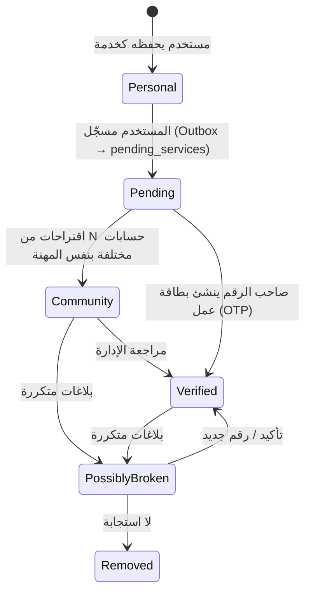

# الخلفية السحابية (Firebase Backend)

> المرجع: [PRD §17](PRD.md#17-الخلفية-السحابية-firebase)

## 1. الخدمات المستخدمة
| الخدمة | الاستخدام |
|---|---|
| Auth (Phone) | تسجيل برقم الهاتف + OTP — يثبت ملكية الرقم (أساس التوثيق) |
| Firestore | الدليل، البطاقات، الاقتراحات، التقييمات، الإشارات، البلاغات |
| Cloud Functions (TS) | كل منطق الثقة والترقية والتحديث — العميل لا يكتب الحقول الحساسة |
| FCM | تحديث صامت للخدمات (Topics) |
| Remote Config | عتبات (5 مقترحين، 30 ثانية…)، قاموس الكلمات، Feature Flags |
| App Check | Play Integrity / App Attest |
| Crashlytics, Analytics, Performance | المراقبة |
| Hosting | لوحة إدارة ويب للتوثيق ومراجعة البلاغات |

## 2. هيكل المجموعات

```text
users/{uid}
services/{serviceId}
business_cards/{cardId}
pending_services/{phoneE164}
    suggestions/{uid}
ratings/{serviceId}/entries/{uid}
call_signals/{serviceId}/entries/{uid_yyyyMMdd}
reports/{reportId}
professions/{professionId}
analytics_private/{serviceId}
    daily/{yyyyMMdd}              // impressions, profileViews, saves, calls, shares, callDurationSum
admin/{uid}                       // صلاحيات الإدارة (أو Custom Claims)
disputes/{disputeId}              // سجل النزاعات (خاص بالمستخدم)
arham_messages/{messageId}        // رسائل أتمتة أرحام الداخلية
provider_stats/{serviceId}        // مستند مجمّع واحد لكل مزود خدمة (Aggregated Stats Document)
```

تفاصيل الحقول في [PRD §17.1](PRD.md#171-مجموعات-firestore).

## 3. دورة حياة رقم خدمي



## 4. Cloud Functions

| الدالة | المُطلق | العمل |
|---|---|---|
| `onSuggestionCreate` | `pending_services/{p}/suggestions/{uid}` | يتحقق أن المقترح ليس صاحب الرقم، يحدث العداد والمهنة الغالبة، يرقّي إلى COMMUNITY عند العتبة |
| `onBusinessCardWrite` | `business_cards/{id}` | يتحقق `phoneE164 == auth.token.phone_number`، ينشئ/يحدث `services` كـ VERIFIED، إن تغير الرقم يضيف القديم لـ `previousPhones` ويرسل FCM للـ Topic |
| `onRatingCreate` | `ratings/{sid}/entries/{uid}` | يتحقق من وجود `call_signal` لنفس المستخدم بمدة ≥ العتبة، يحدث المتوسط الموزون |
| `onCallSignalCreate` | `call_signals/{sid}/entries/{id}` | Rate limit يومي (معرّف المستند)، يحدث uniqueCallers و retentionRate و trustScore و isHot |
| `onReportCreate` | `reports/{id}` | عند N بلاغات: `possiblyBroken=true`؛ إن اتفقت البلاغات على رقم جديد ← يُقترح على الإدارة |
| `lookupNumber` (Callable) | العميل | يُرجع خدمة عامة لرقم مُطبّع (لفحص الإضافة) — مع Rate Limit و App Check |
| `trackImpressions` (Callable) | العميل (Batched) | زيادة عدادات `analytics_private` |
| `recomputeHotness` (Scheduled) | يومياً | إعادة حساب 🔥 حسب النشاط في آخر 7 أيام لكل منطقة |
| `aggregateDashboard` (Scheduled) | يومياً | تجميع `analytics_private/{serviceId}/daily` ← حساب: إجمالي الظهور/الزيارات/الحفظ/المكالمات/المشاركات + متوسط مدة المكالمة + عدد العملاء الفريدون + نسبة العودة ← كتابة `analytics_private/{serviceId}/summary` |
| `getDashboardData` (Callable) | العميل (Pro) | يُرجع ملخص الفترة المطلوبة لصاحب الخدمة — مع التحقق من `accountType == "pro"` |
| `sendArhamMessage` (Callable) | العميل | ينشئ مستند في `arham_messages` ويُرسل FCM Push للمستقبِل (إن كان مستخدم صِلَة) — Rate limit: 10 رسائل/ساعة |
| `processScheduledMessages` (Scheduled) | كل 15 دقيقة | يقرأ `scheduled_messages` التي حان وقتها من Firestore ← يُرسل FCM Push أو يُعيد جدولة الموعد القادم |
| `sendEmergencyCriticalAlert` (Callable) | العميل | يُرسل Critical Alert عبر FCM لمستخدم صِلَة آخر (iOS) — محصور بجهات اتصال `EMERGENCY` + Rate limit: 3/24 ساعة |
| `deleteUserData` | Auth onDelete | حذف بيانات المستخدم وإعادة حساب ما يلزم |

## 5. حساب الثقة

```text
retentionRate = callers_with_2plus_calls_in_30d / unique_callers
weightedRating = Σ(rating × w_account) / Σ(w_account)
trust = 0.45·retentionRate + 0.30·(weightedRating/3) + 0.20·min(1, log10(1+uniqueCallers)/3) + (verified ? 0.05 : 0)
w_account = clamp(accountAgeDays/90, 0.2, 1.0) × (isActive ? 1 : 0.5)
isHot = calls_last_7d في نفس geohash(5) ضمن أعلى 10%
```
المعاملات في Remote Config لضبطها بدون تحديث التطبيق.

## 6. FCM — التحديث الصامت
- العميل يشترك في `service_{serviceId}` عند حفظ خدمة سحابية، ويلغي عند الحذف.
- الحمولة (Data only): `{ "type": "service_updated", "serviceId": "...", "version": "..." }`.
- أندرويد: `FirebaseMessagingService.onMessageReceived` ← `ServicesSyncWorker` (Expedited).
- iOS: `content-available: 1` ← `application(_:didReceiveRemoteNotification:)` ← مزامنة.

## 7. الفهارس المطلوبة (Firestore Indexes)
- `services`: `(professionId, geohash)`، `(visibility, geohash)`، `(professionId, trustScore desc)`.
- `services`: `phoneE164` (مساواة).
- `reports`: `(serviceId, createdAt)`.
- `disputes`: `(ownerUid, createdAt desc)`.
- `arham_messages`: `(recipientUid, createdAt desc)`، `(senderUid, createdAt desc)`.

## 8. قواعد الأمان
انظر [PRD §17.3](PRD.md#173-قواعد-الأمان-مقتطف). إضافات:
- اختبار القواعد بـ **Firebase Emulator Suite** + `@firebase/rules-unit-testing` في CI.
- الحقول المحسوبة (`trustScore`, `visibility`, `uniqueCallers`) لا يكتبها إلا Admin SDK.
- `disputes/{disputeId}`: `allow read, write: if signedIn() && resource.data.ownerUid == request.auth.uid;`
- `arham_messages/{messageId}`: `allow read: if signedIn() && (resource.data.senderUid == request.auth.uid || resource.data.recipientUid == request.auth.uid); allow create: if false;` — الكتابة عبر Cloud Functions فقط.
- `provider_stats/{serviceId}`: `allow read, write: if false;` — Cloud Functions فقط.

## 9. البيئات
| البيئة | المشروع | الاستخدام |
|---|---|---|
| dev | `sila-dev` | التطوير + Emulators |
| staging | `sila-staging` | الاختبار الداخلي |
| prod | `sila-prod` | الإنتاج |

أندرويد: Product Flavors · iOS: Build Configurations + ملفات plist منفصلة.

## 10. التكلفة (ملاحظات)
- الضيوف يقرؤون الدليل ← استخدم Pagination و Cache محلي (Room) و `limit()` دائماً.
- اجمع الـ Impressions محلياً وأرسلها Batched (مرة كل بضع ساعات).

## 11. نمط المستند المجمّع (Aggregated Stats Document)

> [!TIP]
> هذا النمط يقلل القراءات من **150M إلى 300K** شهرياً للوحة التحكم (Pro). انظر [COST_ANALYSIS.md](COST_ANALYSIS.md) للتفصيل.

**المشكلة:** لو قرأنا كل مستندات `analytics_private/{serviceId}/daily/*` عند فتح لوحة التحكم، كل فتح = ~30 قراءة (يوم لكل يوم في الشهر) × عدد مزودي الخدمة.

**الحل:** Cloud Function `aggregateDashboard` (يومياً) تقرأ مستندات `daily` وتكتب ملخصاً واحداً في:
```text
provider_stats/{serviceId}
├── summary: { impressions, views, saves, calls, shares, avgDuration, uniqueCallers, returnRate, trustScore }
├── weeklyTrend: [{ date, impressions, views }]  // آخر 4 أسابيع
└── lastUpdated: Timestamp
```

**النتيجة:** فتح لوحة التحكم = **قراءة واحدة فقط** (مستند `provider_stats/{serviceId}`).

## 12. استراتيجية التخزين البديل (Cloudflare R2)

> [!NOTE]
> للتطبيق في مرحلة النمو (> 50K مستخدم) عند ارتفاع تكلفة Firebase Storage / Egress.

| المعيار | Firebase Storage | Cloudflare R2 |
|---|---|---|
| التخزين | \$0.026/GB | \$0.015/GB |
| Egress | \$0.12/GB | **مجاني** |
| المنطقة | واحدة | تلقائي عبر CDN |

**متى ننتقل:**
- عندما يتجاوز Egress الشهري **10 GB** (\$1.2/شهر) — عادة عند ~50K DAU.
- **آلية الانتقال:** Cloudflare Worker كـ Proxy أمام R2 + Upload عبر Cloud Function.
- الصور المرشحة: صور الأعمال (Pro)، صور النزاعات، صور بطاقات العمل.
- صور الأفاتار: **لا تحتاج تخزيناً** — نستخدم الأحرف الأولى (Avatar Letters) لـ 90% من المستخدمين.
