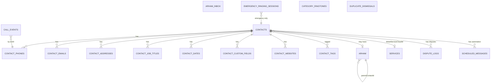

# نموذج البيانات (Data Model)

> المرجع: [PRD §16](PRD.md#16-نماذج-البيانات). السحابة: [BACKEND_FIREBASE.md](BACKEND_FIREBASE.md).

## 1. مخطط العلاقات (Room)



## 2. الجداول

### contacts
| العمود | النوع | ملاحظات |
|---|---|---|
| id | Long PK | |
| systemContactId | String UNIQUE | مفتاح المزامنة الدائم: Android `LOOKUP_KEY` / iOS `identifier` (ADR-0009) |
| lookupKey | String? | أندرويد — مرآة `LOOKUP_KEY` لبناء `CONTENT_LOOKUP_URI` |
| accountType / accountName | String? | phone / com.google / sim |
| displayName, fileAs | String | |
| prefix, firstName, middleName, lastName, suffix, nickname, phoneticName | String? | |
| company, department | String? | |
| photoUri | String? | |
| category | Category | افتراضي UNCATEGORIZED |
| isFavorite | Boolean | |
| customRingtoneUri | String? | |
| sendToVoicemail, isBlocked | Boolean | |
| notes | String? | |
| linkedServiceCloudId | String? | |
| excludeFromSmartFilter | Boolean | |
| normalizedName | String | للبحث والمكررات (تطبيع عربي) |
| createdAt, updatedAt | Long | |
| systemDeletedAt | Long? | **يُضاف في المرحلة 1** ([ADR-0010](adr/0010-incremental-contacts-sync.md)) — تعليم حذف ناعم يُخفى من القائمة ويُنظَّف بعد 30 يوماً |

### الجداول الفرعية (كلها `contactId` FK + CASCADE)
| الجدول | الأعمدة |
|---|---|
| contact_phones | raw, **e164 (Index)**, type, label, isPrimary, preferredSimSlot? |
| contact_emails | address, type, label |
| contact_addresses | street, city, region, postalCode, country, type |
| contact_job_titles | title |
| contact_dates | type (BIRTHDAY, ANNIVERSARY, CUSTOM), label, month, day, year? |
| contact_custom_fields | label, value |
| contact_websites | url, type |
| contact_tags | tag (Index) — وسوم مستخرجة/يدوية |

### contacts_fts (FTS4)
`displayName, nickname, company, notes, normalizedName` — محتوى مرتبط بـ `contacts`.

### arham
| العمود | النوع |
|---|---|
| contactId | Long PK/FK |
| relation | Relation (enum) |
| layer | KinshipLayer |
| parentContactId | Long? |
| frequency | ArhamFrequency |
| lastContactedAt | Long? |
| pausedUntil | Long? |
| createdAt | Long |

### call_events
`id PK, primarySource (IN_APP/ANDROID_CALL_SCREENING/ANDROID_TELEPHONY_OBSERVER/IOS_CALL_OBSERVER/MANUAL), evidenceSourcesJson, timestamp (Index), remoteNumber? (Index), contactId? (FK), direction?, startedAt?, connectedAt?, endedAt?, durationSec?, outcome (ATTEMPTED/CONNECTED/COMPLETED/UNANSWERED/UNKNOWN), association, confirmation, confidence, dedupeKey?, simSlot?`
> عقد الحدث ومصادره في [ADR-0006](adr/0006-call-log-strategy.md). الحقول الاختيارية تعني «المنصة لم تكشفها» ولا تُشتق أو تُخترع. يُحتفظ بالأحداث 365 يوماً ثم تُحذف تلقائياً. المخطط الحالي في المرحلة 0 (`callLogId`, `e164`, `source = CALL_LOG/IN_APP/OBSERVER/MANUAL`) مبدئي ويتطلب هجرة Room في المرحلة 1.

### services
`cloudId PK, name, professionId, phoneE164 (Index), previousPhones, visibility, trustScore, uniqueCallers, retentionRate, ratingAvg, ratingCount, isHot, geohash (Index), lat, lng, city, workingHoursJson, ownerVerified, isSavedByUser, myRating, myCallCount, myLastCallAt, possiblyBroken, syncedAt`

### professions (Cache)
`id PK, nameAr, nameEn, icon, keywordsJson, parentId, suppliersJson, isB2B`

### أخرى
- `duplicate_dismissals(contactIdA, contactIdB)` PK مركب.
- `category_ringtones(category PK, ringtoneUri)`.
- `smart_filter_feedback(normalizedToken, category, accepted)` للتعلم المحلي.
- `pending_uploads(id, type, payloadJson, createdAt, attempts)` — Outbox لعمليات السحابة (اقتراح خدمة، تقييم، إشارة اتصال) لضمان الإرسال عند عودة الإنترنت.

### dispute_logs
| العمود | النوع | ملاحظات |
|---|---|---|
| id | Long PK | |
| serviceCloudId | String | FK للخدمة المعنية |
| description | String | نص المشكلة (حتى 500 حرف) |
| imageUris | String? | JSON array لمسارات الصور المحلية (حتى 3) |
| cloudImageUrls | String? | JSON array لروابط Firebase Storage |
| status | DisputeStatus | `OPEN` → `RESOLVED` → `ARCHIVED` |
| cloudDisputeId | String? | معرّف Firestore بعد المزامنة |
| createdAt | Long | |
| updatedAt | Long | |
| resolvedAt | Long? | |

### scheduled_messages
| العمود | النوع | ملاحظات |
|---|---|---|
| id | Long PK | |
| contactId | Long FK | القريب المستهدف |
| type | AutomationType | `IN_APP_MESSAGE` · `AUTO_RING` |
| messageText | String? | نص الرسالة (للرسائل فقط) |
| recurrence | RecurrenceRule | JSON: نوع التكرار + الأيام + الوقت |
| nextFireAt | Long (Index) | الموعد القادم للتنفيذ |
| isEnabled | Boolean | |
| createdAt | Long | |
| updatedAt | Long | |

### arham_inbox
| العمود | النوع | ملاحظات |
|---|---|---|
| id | Long PK | |
| cloudMessageId | String? UNIQUE | معرّف Firestore |
| senderUid | String | |
| senderName | String | |
| recipientUid | String | |
| messageText | String | |
| reaction | String? | ❤️ 🤲 👍 😊 |
| direction | MessageDirection | `SENT` · `RECEIVED` |
| status | MessageStatus | `PENDING` · `SENT` · `DELIVERED` · `READ` |
| sentAt | Long (Index) | |
| readAt | Long? | |

### emergency_ringing_sessions
| العمود | النوع | ملاحظات |
|---|---|---|
| id | Long PK | |
| contactId | Long FK | جهة اتصال طوارئ فقط |
| phoneE164 | String | |
| attempts | Int | عدد المحاولات |
| maxAttempts | Int | الحد الأقصى (افتراضي 10) |
| status | RingingStatus | `IN_PROGRESS` · `ANSWERED` · `STOPPED_BY_USER` · `MAX_REACHED` · `BLOCKED` |
| startedAt | Long | |
| endedAt | Long? | |

## 3. التعدادات (Enums)

```kotlin
enum class Category { FAMILY, FRIENDS, WORK, SERVICES, EMERGENCY, UNCATEGORIZED }
enum class ServiceVisibility { PERSONAL, COMMUNITY, VERIFIED }
enum class ArhamFrequency(val days: Int) { DAILY(1), WEEKLY(7), BIWEEKLY(14), MONTHLY(30), OCCASIONS(0) }
enum class ArhamStatus { OVERDUE, SOON, OK }      // أحمر / أصفر / أخضر
enum class KinshipLayer { ANCESTOR, SELF_BRANCH, COLLATERAL_PATERNAL, COLLATERAL_MATERNAL, SPOUSE_SIDE, OTHER }
enum class Relation(val layer: KinshipLayer) {
    GRANDFATHER(ANCESTOR), GRANDMOTHER(ANCESTOR), FATHER(ANCESTOR), MOTHER(ANCESTOR),
    BROTHER(SELF_BRANCH), SISTER(SELF_BRANCH), SON(SELF_BRANCH), DAUGHTER(SELF_BRANCH), SPOUSE(SELF_BRANCH),
    UNCLE_PATERNAL(COLLATERAL_PATERNAL), AUNT_PATERNAL(COLLATERAL_PATERNAL), COUSIN_PATERNAL(COLLATERAL_PATERNAL),
    UNCLE_MATERNAL(COLLATERAL_MATERNAL), AUNT_MATERNAL(COLLATERAL_MATERNAL), COUSIN_MATERNAL(COLLATERAL_MATERNAL),
    IN_LAW(SPOUSE_SIDE), CLOSE_FRIEND(OTHER), CUSTOM(OTHER)
}
enum class NumberUsage { PERSONAL, WORK, BOTH }
enum class Rating(val value: Int) { BAD(1), OK(2), EXCELLENT(3) }

// --- New Enums ---
enum class DisputeStatus { OPEN, RESOLVED, ARCHIVED }
enum class AutomationType { IN_APP_MESSAGE, AUTO_RING }
enum class MessageDirection { SENT, RECEIVED }
enum class MessageStatus { PENDING, SENT, DELIVERED, READ }
enum class RingingStatus { IN_PROGRESS, ANSWERED, STOPPED_BY_USER, MAX_REACHED, BLOCKED }
```

## 4. نماذج الـ Domain (مختصر)

```kotlin
data class Contact(
    val id: Long, val name: ContactName, val photoUri: String?,
    val phones: List<Phone>, val emails: List<Email>, val addresses: List<Address>,
    val organization: Organization?, val dates: List<ImportantDate>,
    val customFields: List<CustomField>, val websites: List<String>,
    val category: Category, val isFavorite: Boolean, val ringtoneUri: String?,
    val sendToVoicemail: Boolean, val isBlocked: Boolean, val notes: String?,
    val account: ContactAccount?, val arham: ArhamInfo?, val linkedService: ServiceRef?,
)

data class ArhamItem(
    val rank: Int, val contactId: Long, val displayName: String, val photoUri: String?,
    val relation: Relation, val frequency: ArhamFrequency,
    val daysSinceLastContact: Int?, val urgency: Double, val status: ArhamStatus, val primaryPhone: String,
)

data class ArhamDashboardStats(
    val period: Period, val topThree: List<ArhamItem>, val totalFamilyCalls: Int,
    val longestCallSec: Int, val contactedRelatives: Int, val goalCompletion: Float,
)

data class ProDashboard(
    val period: DashboardPeriod,
    val trustScore: Int,                      // 0–100
    val trustLabel: String,                   // "ممتاز" / "جيد" / "يحتاج تحسين"
    val impressions: TrendStat,               // الظهور + Sparkline
    val profileViews: TrendStat,              // الزيارات
    val saves: TrendStat,                     // الحفظ
    val inboundCalls: StatCard,               // المكالمات الواردة
    val positiveRatingPercent: StatCard,       // التقييمات الإيجابية %
    val avgCallDurationSec: StatCard,          // متوسط مدة المكالمة
    val shares: StatCard,                     // مرات المشاركة
    val uniqueCallers: StatCard,              // العملاء الفريدون
    val returnRate: StatCard,                 // نسبة العودة %
    val trendText: String,                    // "↑ 12% عن الأسبوع الماضي"
    val trendPositive: Boolean,
)

data class TrendStat(val value: Int, val sparkline: List<Float>, val trendUp: Boolean?)
data class StatCard(val value: String, val status: StatStatus)
enum class StatStatus { NORMAL, HIGHER, LOWER }
enum class DashboardPeriod { TODAY, WEEK, MONTH, CUSTOM }

data class DisputeLog(
    val id: Long, val serviceCloudId: String, val description: String,
    val localImageUris: List<String>, val cloudImageUrls: List<String>,
    val status: DisputeStatus, val createdAt: Long, val resolvedAt: Long?,
)

data class ScheduledMessage(
    val id: Long, val contactId: Long, val contactName: String,
    val type: AutomationType, val messageText: String?,
    val recurrence: RecurrenceRule, val nextFireAt: Long, val isEnabled: Boolean,
)

data class RecurrenceRule(
    val type: RecurrenceType,           // DAILY, WEEKLY, MONTHLY, CUSTOM, ONCE
    val daysOfWeek: Set<DayOfWeek>?,    // للأسبوعي/المخصص
    val dayOfMonth: Int?,               // للشهري
    val timeOfDay: LocalTime,
)
enum class RecurrenceType { DAILY, WEEKLY, MONTHLY, CUSTOM, ONCE }

data class ArhamInboxMessage(
    val id: Long, val senderName: String, val messageText: String,
    val reaction: String?, val direction: MessageDirection,
    val status: MessageStatus, val sentAt: Long,
)

data class EmergencyRingingSession(
    val id: Long, val contactId: Long, val contactName: String,
    val phoneE164: String, val attempts: Int, val maxAttempts: Int,
    val status: RingingStatus, val startedAt: Long,
)
```

## 5. منطق حساب الحالة (مرجعي)

```kotlin
fun ArhamEntity.urgency(now: Instant): Double {
    if (frequency == ArhamFrequency.OCCASIONS) return 0.0
    val last = lastContactedAt ?: return Double.MAX_VALUE
    val days = (now.toEpochMilliseconds() - last) / 86_400_000.0
    return days / frequency.days
}
fun Double.toStatus() = when { this >= 1.0 -> OVERDUE; this >= 0.7 -> SOON; else -> OK }
```

## 6. DataStore — `UserPreferences`
انظر [features/07-ringtones-preferences.md](features/07-ringtones-preferences.md#مفاتيح-التخزين) للمفاتيح والقيم الافتراضية.

## 7. سياسة الـ Migrations
- `exportSchema = true` وحفظ ملفات المخطط في `shared/core/database/schemas/`.
- كل تغيير = Migration + اختبار `MigrationTestHelper`.
- ممنوع `fallbackToDestructiveMigration` في الإنتاج.
