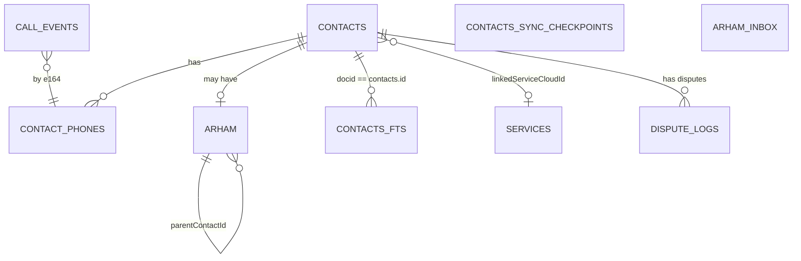

# نموذج البيانات (Data Model)

> المرجع: [PRD §16](PRD.md#16-نماذج-البيانات). السحابة: [BACKEND_FIREBASE.md](BACKEND_FIREBASE.md).
>
> **PR B ([ADR-0011](adr/0011-room3-single-schema-authority.md)):** Room 3 KMP (`androidx.room3`, KSP) هو **صاحب المخطط الوحيد** — الكيانات في
> `:core:database/entity/` هي المرجع الحرفي للواقع الفيزيائي (`@Database(version = 1)` + مخططات مولَّدة في
> `core/database/schemas/`). هذا الملف يوثّق الجداول **الفعلية** حصراً؛ ما لم يُنشأ فيزيائياً يُوسَم «تصميم مستقبلي».

## 1. مخطط العلاقات (Room)

الجداول الفعلية التسعة (8 مُدارة من Room + `contacts_fts` عبر Callback): `contacts`, `contact_phones`,
`contacts_fts`, `arham`, `services`, `call_events`, `arham_inbox`, `dispute_logs`, `contacts_sync_checkpoints`.



> القيود المرجعية (FK) **توثيقية فقط** — لا قيود FK فيزيائية في المخطط (ADR-0011 · Decision 5)،
> والسلامة المرجعية تُدار داخل معاملات الكتابة المركّبة.
> جداول التصميم المستقبلي (contact_emails/addresses/dates/custom_fields/websites/tags,
> scheduled_messages, emergency_ringing_sessions, category_ringtones, duplicate_dismissals…)
> **لا وجود فيزيائياً لها** — تُضاف مع كيانات Room وترحيلات عند تنفيذ ميزاتها.

## 2. الجداول

### contacts
| العمود | النوع | ملاحظات |
|---|---|---|
| id | Long PK | |
| systemContactId | String, **Index غير فريد** | مفتاح المزامنة الدائم: Android `LOOKUP_KEY` / iOS `identifier` (ADR-0009). **بلا قيد UNIQUE فيزيائياً** — التفرد المنطقي يُدار في طبقة التطبيق، والسجلات المكررة تُحفظ كما هي (ADR-0011 · Decision 5) |
| lookupKey | String? | أندرويد — مرآة `LOOKUP_KEY` لبناء `CONTENT_LOOKUP_URI` |
| accountType / accountName | String? | phone / com.google / sim |
| displayName, fileAs | String | |
| prefix, firstName, middleName, lastName, suffix, nickname, phoneticName | String? | |
| company, department | String? | |
| photoUri | String? | |
| category | Category | افتراضي UNCATEGORIZED |
| isFavorite | Boolean | |
| customRingtoneUri | String? | |
| sendToVoicemail, isBlocked | Boolean | |
| notes | String? | |
| linkedServiceCloudId | String? | |
| excludeFromSmartFilter | Boolean | |
| normalizedName | String | للبحث والمكررات (تطبيع عربي) |
| createdAt, updatedAt | Long | |
| systemDeletedAt | Long? | **مُنفَّذ في المرحلة 1 (v2 — Issue #23)** ([ADR-0010](adr/0010-incremental-contacts-sync.md)) — تعليم حذف ناعم يُخفى من القائمة ويُنظَّف بعد 30 يوماً؛ تكتبه المزامنة حصراً (حذف مؤكد من المنصة/مصالحة كاملة) ولا تكتبه إبطال الصلاحية ولا `.limited` أبداً |

> **حالة تنفيذ المخطط (v2 ثم v4 — تصحيح توثيقي 2026-11-08):** أعمدة `contacts` أعلاه كلها
> مُنفَّذة في المخطط الفعلي، مع ترقية v1→v2 عبر `ALTER TABLE ADD COLUMN` (بلا إعادة بناء ولا
> فقدان بيانات) وفهرس بحث FTS مُعاد تعبئته idempotently للصفوف القديمة. **جداول الحقول
> القياسية الخمسة موجودة فعلاً منذ v2** (`contact_emails` / `contact_addresses` /
> `contact_dates` / `contact_custom_fields` / `contact_websites` — انظر ADR-0012 §2)، وسطر
> «غير مخزّنة بعد» أدناه كان قديماً مقابل ADR-0012 ويُصحَّح هنا. `contact_tags` يبقى تصميماً
> مستقبلياً غير مخزّن (القيم في `contacts.tags` كنص مفصول).

### الجداول الفرعية
جداول فرعية فعلية: **contact_phones** + خمسة جداول حقول قياسية (v2 — ADR-0012):
`contact_phones`: `id (PK autoincrement), contactId (Index), raw, e164 (Index), type (افتراضي 'MOBILE'), isPrimary (افتراضي 0)` —
مع عمودَي **`label`/`sortOrder`** (v2 — تسمية صِلَة-فقط للهاتف وترتيبه، تُكتب في `EntityMappers`).

> `preferredSimSlot` لا يوجد فيزيائياً (تصميم مستقبلي). بقية جداول التصميم المستقبلي
> (contact_tags/job_titles) **غير مخزّنة بعد** (القيم تُسقَط عند المزامنة وتُوثَّق هنا عند
> إضافتها).

### جداول الدمج والفلترة الذكية (v4 — T7 · Issue #28 · ADR-0013)
تُنشأ عبر `MergeTablesDdl` (مصدر DDL وحيد يستهلكه `MIGRATION_3_4` وشيم اعتماد القواعد
القديمة — ADR-0011)، ومحتوى اللقطات JSON معتم داخله بلا أي PII خارج الجهاز:

| الجدول | الغرض | الأعمدة المفتاحية |
|---|---|---|
| `contact_merge_snapshots` | لقطة ما-قبل-الدمج للتراجع خلال جلسة الشاشة | `id` PK، `groupId`، `payloadJson`، `status` (`ACTIVE`/`RESTORED`/`EXPIRED` — قفل لمرة-واحدة)، `expiresAt` + فهرسان |
| `duplicate_dismissals` | «ليست مكررات» لكل ثنائية بمفتاحها الثابت | `groupKey` (مفهرس)، `reason`، `createdAt` |
| `smart_filter_feedback` | تعلّم محلي token→category | PK مركّب `(token, suggestedCategory)`، `acceptedCount`/`rejectedCount` |

### contacts_fts (FTS4)
`displayName, nickname, company, department, notes, normalizedName` — **جدول FTS4 مستقل** بـ `docid = contacts.id`
(القرار مثبَّت بالاختبار: الوضع المستقل يدعم الحذف بـ docid والمطابقة العربية معاً، بينما فشل
وضع `content=` الخارجي في الحذف — انظر اختبارات `ContactsSyncDaoTest`). صيانته داخل نفس
معاملة كتابة/قبور المزامنة حصراً: الإدراج/التحديث في `writeContactToSqlite`، والحذف عند
القبر والحذف النهائي، وإعادة تعبئة idempotent عند الترقية للصفوف القديمة. تُخفى المقبورة
من الفهرس. يقرأه مسار البحث الإنتاجي عبر `ContactDao.searchContacts` (T3 — Issue #24).

> **آلية الإنشاء في Room 3 (PR B — ADR-0011 القرار 1):** الجدول ليس كياناً مُداراً من Room —
> KSP على أهداف Native (iOS) لا يعالج كيانات `@Fts4` المستقلة (خلل Room 3.0.3: فشل حلّ
> القيمة الافتراضية لـ `contentEntity` من klib). يُنشأ عبر `RoomDatabase.Callback.onOpen`
> بعبارة DDL موحّدة حرفية (`LegacyFtsDdl.CREATE_CONTACTS_FTS` — مستقل بلا `content=`،
> توكنِزِر SIMPLE، بلا مشغّلات) مع `IF NOT EXISTS`، ولا يظهر في مخطط `schemas/1.json`
> المُصدَّر — مرجعيته العبارة الموحّدة + بصمة الاعتماد + اختبارات التشغيل.

**عمود `department` (T3 — Issue #24):** موجود في الفهرس الفيزيائي (بحث المسمى الوظيفي/القسم).
جداول FTS4 لا تدعم `ALTER TABLE ADD COLUMN` — فمسار الاعتماد (ADR-0011) يُعيد إنشاء الجدول
ويُعيد تعبئته idempotently من `contacts` عند غياب أي من الأعمدة الستة المستهدفة (بلا ترقية
إصدار Room ولا فقدان بيانات — انظر اختبار الترحيل في `ContactsSearchDaoTest`).

**توكنة الفهرس (T3 — قرارات البحث):** كل الأعمدة تُخزَّن **بنص معايَر عبر `ArabicTextNormalizer`**
(توحيد الهمزات أإآ→ا، ة→ه، ى→ي، الأرقام العربية-الهندية→غربية، إسقاط التشكيل، أحرف لاتينية
صغيرة) — نفس تعريب الاستعلام في `searchContacts`؛ تخزين النص الخام يجعل الاستعلامات المتعاربة
لا تطابق (مثال مثبت بالاختبار: «المالية» تُطبَّع «الماليه» فلا تطابق توكن «الماليه» المخزَّن خاماً).
الاستعلام: توكنات مطهرة من محارف FTS المشغّلة + `*` بادئي، مربوطة بـ AND، مع اتحاد مسار ثانٍ
`LIKE` على أجزاء الأرقام في `contact_phones`؛ الاستعلام الفارغ يعيد كل الجهات الحيّة.

### contacts_sync_checkpoints (Issue #23 · ADR-0010 §4/§8)
جدول مفتاح/قيمة لتخزين نقاط استئناف المزامنة — القيم معتمة (String) وفكّها مسؤولية
`:feature:contacts:data` عبر `ContactsSnapshotCodec`:
| المفتاح | القيمة |
|---|---|
| `contacts_snapshot` | JSON مغلف v1: علامة المنصة + بايتات رمز iOS (Base64) + خريطة نُسَخ Android الخام |
| `last_full_reconcile_at` | ختم آخر مصالحة كاملة ناجحة (مللي ثانية كنص) — بوابة المصالحة الأسبوعية |

**قيد ذرّية صارم:** اللقطة/الختم تُكتبان داخل **نفس معاملة** كتابة دفعة الدلتا (أو الدفعة
الأخيرة من الاستيراد الكامل) حصراً — فشل أي دفعة يُرجِع كل شيء ولا يُقدَّم رمز/لقطة أبداً.

### arham
| العمود | النوع |
|---|---|
| contactId | Long PK/FK |
| relation | Relation (enum) |
| layer | KinshipLayer |
| parentContactId | Long? |
| frequency | ArhamFrequency |
| lastContactedAt | Long? |
| pausedUntil | Long? |
| createdAt | Long |

### call_events (6 أعمدة فعلية)
`callLogId PK, e164, direction, durationSec, timestamp (Index), source (CALL_LOG/IN_APP/OBSERVER/MANUAL)`
> عقد الحدث ومصادره في [ADR-0006](adr/0006-call-log-strategy.md). هذه هي الصورة الفيزيائية
> الحرفية بفهرس واحد على `timestamp` (ADR-0011)؛ حقول عقد ADR-0006 الغنية (evidenceSources,
> contactId, startedAt/connectedAt/endedAt, outcome…) تصميم مستقبلي يُضاف مع كيان Room
> وترحيل عند تنفيذ المرحلة 1. يُحتفظ بالأحداث 365 يوماً ثم تُحذف تلقائياً (F-02).

### services (16 عموداً فعلياً)
`cloudId PK, name, professionId (Index), professionNameAr, professionNameEn, phoneE164 (Index), visibility, trustScore, uniqueCallers, retentionRate, ratingAvg, ratingCount, isHot (افتراضي 0), city?, ownerVerified (افتراضي 0), isSavedByUser (افتراضي 0)`
> حقول العرض/التعلم (geohash, lat/lng, workingHoursJson, previousPhones, myRating,
> myCallCount, myLastCallAt, possiblyBroken, syncedAt) **غير مخزّنة فيزيائياً** — قيم الـ
> Domain المحايدة تُشتق في المappers (ADR-0011).

### dispute_logs (7 أعمدة فعلية)
| العمود | النوع | ملاحظات |
|---|---|---|
| id | Long PK | |
| serviceCloudId | String | FK للخدمة المعنية |
| description | String | نص المشكلة (حتى 500 حرف) |
| status | DisputeStatus | `OPEN` → `RESOLVED` → `ARCHIVED` |
| createdAt | Long | |
| updatedAt | Long | |
| resolvedAt | Long? | |
> حقول المرفقات والمزامنة السحابية (`imageUris`, `cloudImageUrls`, `cloudDisputeId`) **غير مخزّنة فيزيائياً بعد** — قيم الـ Domain المحايدة تُشتق في `EntityMappers` (ADR-0011).

### scheduled_messages — **تصميم مستقبلي (لا جدول فيزيائياً)**
> لم يُنشأ هذا الجدول إطلاقاً؛ كيانه التجميعي الشبحي أُزيل نهائياً في PR B (ADR-0011 · Decision 1)
> بعد التحقق من انعدام مستهلكيه. تُعاد صياغته عند تنفيذ ميزة الأتمتة.

### arham_inbox (8 أعمدة فعلية)
| العمود | النوع | ملاحظات |
|---|---|---|
| id | Long PK | |
| senderUid | String | |
| senderName | String | |
| recipientUid | String | |
| messageText | String | |
| direction | MessageDirection | `SENT` · `RECEIVED` |
| status | MessageStatus | `PENDING` · `SENT` · `DELIVERED` · `READ` |
| sentAt | Long (Index) | |
> حقول المزامنة والتفاعل (`cloudMessageId`, `reaction`, `readAt`) **غير مخزّنة فيزيائياً بعد** — قيم الـ Domain المحايدة تُشتق في `EntityMappers` (ADR-0011).

### emergency_ringing_sessions — **تصميم مستقبلي (لا جدول فيزيائياً)**
> لم يُنشأ هذا الجدول إطلاقاً؛ كيانه التجميعي الشبحي أُزيل نهائياً في PR B (ADR-0011 · Decision 1)
> بعد التحقق من انعدام مستهلكيه. تُعاد صياغته عند تنفيذ ميزة طوابير الاتصال الطارئ.

## 3. التعدادات (Enums)

```kotlin
enum class Category { FAMILY, FRIENDS, WORK, SERVICES, EMERGENCY, UNCATEGORIZED }
enum class ServiceVisibility { PERSONAL, COMMUNITY, VERIFIED }
enum class ArhamFrequency(val days: Int) { DAILY(1), WEEKLY(7), BIWEEKLY(14), MONTHLY(30), OCCASIONS(0) }
enum class ArhamStatus { OVERDUE, SOON, OK }      // أحمر / أصفر / أخضر
enum class KinshipLayer { ANCESTOR, SELF_BRANCH, COLLATERAL_PATERNAL, COLLATERAL_MATERNAL, SPOUSE_SIDE, OTHER }
enum class Relation(val layer: KinshipLayer) {
    GRANDFATHER(ANCESTOR), GRANDMOTHER(ANCESTOR), FATHER(ANCESTOR), MOTHER(ANCESTOR),
    BROTHER(SELF_BRANCH), SISTER(SELF_BRANCH), SON(SELF_BRANCH), DAUGHTER(SELF_BRANCH), SPOUSE(SELF_BRANCH),
    UNCLE_PATERNAL(COLLATERAL_PATERNAL), AUNT_PATERNAL(COLLATERAL_PATERNAL), COUSIN_PATERNAL(COLLATERAL_PATERNAL),
    UNCLE_MATERNAL(COLLATERAL_MATERNAL), AUNT_MATERNAL(COLLATERAL_MATERNAL), COUSIN_MATERNAL(COLLATERAL_MATERNAL),
    IN_LAW(SPOUSE_SIDE), CLOSE_FRIEND(OTHER), CUSTOM(OTHER)
}
enum class NumberUsage { PERSONAL, WORK, BOTH }
enum class Rating(val value: Int) { BAD(1), OK(2), EXCELLENT(3) }

// --- New Enums ---
enum class DisputeStatus { OPEN, RESOLVED, ARCHIVED }
enum class AutomationType { IN_APP_MESSAGE, AUTO_RING }
enum class MessageDirection { SENT, RECEIVED }
enum class MessageStatus { PENDING, SENT, DELIVERED, READ }
enum class RingingStatus { IN_PROGRESS, ANSWERED, STOPPED_BY_USER, MAX_REACHED, BLOCKED }
```

## 4. نماذج الـ Domain (مختصر)

```kotlin
data class Contact(
    val id: Long, val name: ContactName, val photoUri: String?,
    val phones: List<Phone>, val emails: List<Email>, val addresses: List<Address>,
    val organization: Organization?, val dates: List<ImportantDate>,
    val customFields: List<CustomField>, val websites: List<String>,
    val category: Category, val isFavorite: Boolean, val ringtoneUri: String?,
    val sendToVoicemail: Boolean, val isBlocked: Boolean, val notes: String?,
    val account: ContactAccount?, val arham: ArhamInfo?, val linkedService: ServiceRef?,
)

data class ArhamItem(
    val rank: Int, val contactId: Long, val displayName: String, val photoUri: String?,
    val relation: Relation, val frequency: ArhamFrequency,
    val daysSinceLastContact: Int?, val urgency: Double, val status: ArhamStatus, val primaryPhone: String,
)

data class ArhamDashboardStats(
    val period: Period, val topThree: List<ArhamItem>, val totalFamilyCalls: Int,
    val longestCallSec: Int, val contactedRelatives: Int, val goalCompletion: Float,
)

data class ProDashboard(
    val period: DashboardPeriod,
    val trustScore: Int,                      // 0–100
    val trustLabel: String,                   // "ممتاز" / "جيد" / "يحتاج تحسين"
    val impressions: TrendStat,               // الظهور + Sparkline
    val profileViews: TrendStat,              // الزيارات
    val saves: TrendStat,                     // الحفظ
    val inboundCalls: StatCard,               // المكالمات الواردة
    val positiveRatingPercent: StatCard,       // التقييمات الإيجابية %
    val avgCallDurationSec: StatCard,          // متوسط مدة المكالمة
    val shares: StatCard,                     // مرات المشاركة
    val uniqueCallers: StatCard,              // العملاء الفريدون
    val returnRate: StatCard,                 // نسبة العودة %
    val trendText: String,                    // "↑ 12% عن الأسبوع الماضي"
    val trendPositive: Boolean,
)

data class TrendStat(val value: Int, val sparkline: List<Float>, val trendUp: Boolean?)
data class StatCard(val value: String, val status: StatStatus)
enum class StatStatus { NORMAL, HIGHER, LOWER }
enum class DashboardPeriod { TODAY, WEEK, MONTH, CUSTOM }

data class DisputeLog(
    val id: Long, val serviceCloudId: String, val description: String,
    val localImageUris: List<String>, val cloudImageUrls: List<String>,
    val status: DisputeStatus, val createdAt: Long, val resolvedAt: Long?,
)

data class ScheduledMessage(
    val id: Long, val contactId: Long, val contactName: String,
    val type: AutomationType, val messageText: String?,
    val recurrence: RecurrenceRule, val nextFireAt: Long, val isEnabled: Boolean,
)

data class RecurrenceRule(
    val type: RecurrenceType,           // DAILY, WEEKLY, MONTHLY, CUSTOM, ONCE
    val daysOfWeek: Set<DayOfWeek>?,    // للأسبوعي/المخصص
    val dayOfMonth: Int?,               // للشهري
    val timeOfDay: LocalTime,
)
enum class RecurrenceType { DAILY, WEEKLY, MONTHLY, CUSTOM, ONCE }

data class ArhamInboxMessage(
    val id: Long, val senderName: String, val messageText: String,
    val reaction: String?, val direction: MessageDirection,
    val status: MessageStatus, val sentAt: Long,
)

data class EmergencyRingingSession(
    val id: Long, val contactId: Long, val contactName: String,
    val phoneE164: String, val attempts: Int, val maxAttempts: Int,
    val status: RingingStatus, val startedAt: Long,
)
```

## 5. منطق حساب الحالة (مرجعي)

```kotlin
fun ArhamEntity.urgency(now: Instant): Double {
    if (frequency == ArhamFrequency.OCCASIONS) return 0.0
    val last = lastContactedAt ?: return Double.MAX_VALUE
    val days = (now.toEpochMilliseconds() - last) / 86_400_000.0
    return days / frequency.days
}
fun Double.toStatus() = when { this >= 1.0 -> OVERDUE; this >= 0.7 -> SOON; else -> OK }
```

## 6. DataStore — `UserPreferences`
انظر [features/07-ringtones-preferences.md](features/07-ringtones-preferences.md#مفاتيح-التخزين) للمفاتيح والقيم الافتراضية.

**مفاتيح أضيفت في T3 (Issue #24):**
| المفتاح | النوع | الافتراضي | الغرض |
|---|---|---|---|
| `dismissed_suggestion_ids` | `Set<String>` | `∅` | استبعاد بطاقات الاقتراح المُغلقة (المعرّف مشتق من هوية العناصر: `stableSuggestionId(kind, sortedSystemContactIds)`) — لا تعود البطاقة لنفس العناصر، وتعود عند تغيّرها |
| `swipe_start_action` | `String` | `CALL` | فعل السحب من البداية على صف جهة (منطقياً — M3 يعكسه في RTL) |
| `swipe_end_action` | `String` | `MESSAGE` | فعل السحب من النهاية (واجهة الإعداد في T9) |

## 7. سياسة المخطط والـ Migrations (PR B · ADR-0011)
- **Room 3 KSP هو صاحب المخطط الوحيد:** `@Database(version = 1, exportSchema = true)`، وملفات
  المخطط المولَّدة تُراجَع في `core/database/schemas/`.
- **قواعد `user_version = 0` القائمة** تُعتمَد مرة واحدة عبر مسار التوأمة الآمن (شيم idempotent
  داخل معاملة واحدة + نسخة واقية `sila_local.pre-room-backup` + تحقق ثم ختم الإصدار عبر مسار
  الإنشاء/التحقق لـ Room) — **ممنوع** `Migration(0,1)`؛ التفاصيل في [ADR-0011](adr/0011-room3-single-schema-authority.md).
- **جداول FTS غير المُدارة (`contacts_fts`) لا ترصدها ترحيلات Room الآلية** — أي تعديل مستقبلي
  عليها (أعمدة/توكنِزِر/نقل إلى FTS5) يُدار يدوياً ضمن كود الـ `Migration` نفسه + إعادة تعبئة
  idempotent، مع تحديث عبارة `LegacyFtsDdl` الموحّدة (وإلا ينشئها الـ Callback بشكل قديم عند
  التثبيت الجديد) — انظر [ADR-0011](adr/0011-room3-single-schema-authority.md).
- كل تغيير مستقبلي على المخطط (بعد الإصدار 1) = إصدار `@Database` جديد + `Migration` رسمية
  + اختبار `MigrationTestHelper` + ملف مخطط مُراجَع في الـ PR.
- ممنوع `fallbackToDestructiveMigration` في الإنتاج؛ ممنوع إنشاء أي جدول خارج الكيانات
  المصرَّحة — الاستثناء الوحيد `contacts_fts` (FTS4 المستقل) المُنشأ حصراً عبر
  `RoomDatabase.Callback` بعبارة DDL الموحّدة (`LegacyFtsDdl`) — انظر [ADR-0011](adr/0011-room3-single-schema-authority.md).
