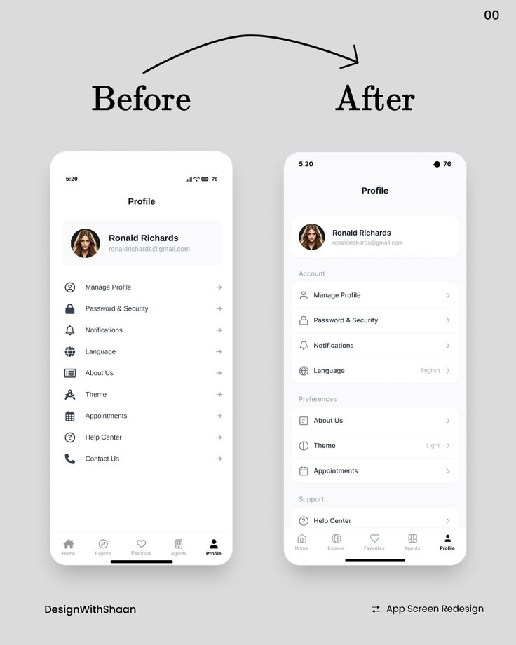
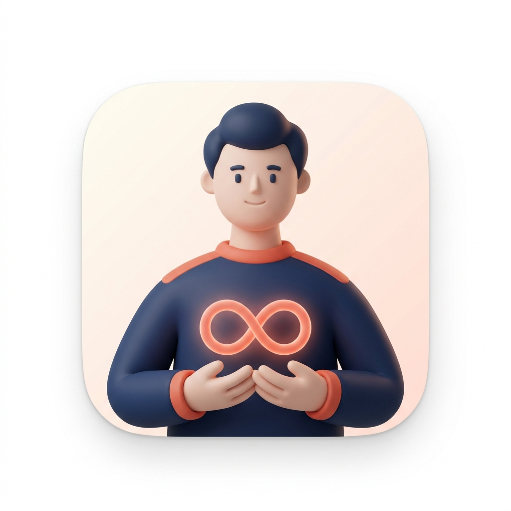

# نظام التصميم (Design System)

> المراجع البصرية: [design-references/](design-references/)

## 1. الألوان

### الألوان الأساسية
| الدور | الاسم | فاتح | داكن |
|---|---|---|---|
| Primary | أخضر زمردي | `#0F9D73` | `#3CCB9A` |
| Secondary | برتقالي غروب (أرحام) | `#FF6A3D` | `#FF8A63` |
| Tertiary | أزرق داكن | `#1E3A5F` | `#9DB8DB` |
| Background | | `#F7F5F2` | `#121212` |
| Surface | | `#FFFFFF` | `#1E1E1E` |
| Surface Variant (بطاقات الإحصاء) | | `#F2F0ED` | `#2A2A2A` |
| On Surface | | `#1B1B1F` | `#E6E1E5` |
| On Surface Variant (نص فرعي) | | `#77757A` | `#A9A6AD` |
| Outline (فواصل) | | `#ECEAE7` | `#3A3A3A` |
| Error | | `#D93F3F` | `#FF7A7A` |

### ألوان التصنيفات
| التصنيف | اللون | الأيقونة |
|---|---|---|
| عائلة | `#E5484D` | ❤ heart |
| أصدقاء | `#F5A524` | 🤝 handshake |
| عمل | `#3E7BFA` | 💼 briefcase |
| خدمات | `#0F9D73` | 🔧 wrench |
| طوارئ | `#8E4EC6` | 🚨 siren |
| غير مصنف | `#9A9A9A` | ○ |

### ألوان حالة أرحام
| الحالة | اللون |
|---|---|
| OVERDUE 🔴 | `#E5484D` |
| SOON 🟡 | `#F5A524` |
| OK 🟢 | `#30A46C` |

### شارات الدليل
| الشارة | اللون |
|---|---|
| موثق ✔ | أخضر `#0F9D73` على `#E6F6F0` |
| مجتمعي | برتقالي `#E07B00` على `#FFF2E0` |
| 🔥 رائج | `#FF6A3D` |
| قد لا يعمل | رمادي + أيقونة تحذير |

## 2. الخطوط
- **الخط:** IBM Plex Sans Arabic (أو Cairo) — يدعم العربية واللاتينية.
- **الأرقام في القائمة المرقمة لأرحام:** خط خفيف كبير (Light، 28sp) كما في المرجع.

| النمط | الحجم/الوزن | الاستخدام |
|---|---|---|
| Display | 28 / Light | أرقام الترتيب 01، 02 |
| Headline | 22 / SemiBold | عناوين الشاشات |
| Title | 17 / SemiBold | أسماء جهات الاتصال، عناوين خيارات الـ Sheet |
| Body | 15 / Regular | النصوص |
| Label | 13 / Medium | Chips، الأزرار |
| Caption | 12 / Regular | النص الفرعي الرمادي |

## 3. المسافات والزوايا
- شبكة **4dp**: 4، 8، 12، 16، 20، 24، 32.
- هوامش الشاشة: 16dp.
- الزوايا: Chips = كامل (Pill)، بطاقات = 20dp، Bottom Sheet = 28dp، المنصة = 24dp، زر الإلغاء = Pill.
- الظلال: خفيفة جداً (Elevation 1–2) — الاعتماد على الألوان أكثر من الظلال.

## 4. المكونات

### 4.1 `SilaActionSheet` — المعيار الموحد للنوافذ المنبثقة


```text
┌──────────────────────────────────┐
│  (icon)  العنوان الرئيسي          │
│          نص فرعي رمادي يشرح       │
│──────────────────────────────────│  ← فاصل باهت
│  (icon)  العنوان                  │
│          الوصف                    │
└──────────────────────────────────┘
         ┌──────────────┐
         │    إلغاء      │            ← Pill منفصل
         └──────────────┘
```
- حاوية بيضاء عائمة، هامش 16dp من الجوانب، زوايا 28dp.
- عنصر: أيقونة Outline 24dp + Title + Caption، ارتفاع أدنى 64dp، منطقة لمس كاملة.
- Scrim: أسود 32%.
- زر الإلغاء منفصل بمسافة 12dp أسفل القائمة، عرض ~60%.
- يدعم: عنصر خطِر (أحمر) للحذف، عنصر محدد (✔) لاختيار الوتيرة.

```kotlin
@Composable
fun SilaActionSheet(
    items: List<ActionItem>,
    onDismiss: () -> Unit,
    title: String? = null,
)
data class ActionItem(val icon: ImageVector, val title: String, val subtitle: String? = null,
                      val destructive: Boolean = false, val selected: Boolean = false, val onClick: () -> Unit)
```

### 4.2 شريط التنقل السفلي الموحد
- 3 عناصر: جهات الاتصال · دليل الخدمات · أرحام.
- أيقونة + تسمية، المؤشر النشط بلون Primary (Secondary في تبويب أرحام).
- Badge رقمي على أرحام = عدد OVERDUE.
- ثابت في الشاشات الرئيسية فقط.

### 4.3 Chips التصنيف مع العدّاد
مستوحاة من [contacts-favorites-tabs.png](design-references/contacts-favorites-tabs.png): `عائلة  3` — العداد في دائرة صغيرة؛ المحدد بخلفية ملونة بلون التصنيف (12% opacity) ونص بلونه.

### 4.4 صف المفضلة
دوائر 64dp مع حلقة 2dp (لون حالة أرحام للعائلة، أو لون التصنيف)، الاسم تحتها سطر واحد.

### 4.5 صف جهة الاتصال
`[صورة 44dp] الاسم / سطر فرعي ........ [أيقونة تصنيف 16dp] [زر اتصال]`

### 4.6 بطاقة الخدمة
`[أيقونة المهنة] الاسم [شارة] / المهنة · المسافة · متاح الآن / مؤشر الثقة ........ [زر اتصال أخضر]`

### 4.7 لوحة أرحام

- **منصة برتقالية** (Secondary) بزوايا 24dp، ثلاثة أعمدة بتدرج أبيض، صور دائرية، إكليل على الأول، زخارف (نجوم/Confetti) خفيفة.
- **بطاقة الإحصاء:** Surface Variant، أعمدة: المؤشر / أنت (مُبرز في بطاقة بيضاء).
- **أشرطة تقدم** ملونة.
- **بطاقة تحفيزية** صفراء فاتحة في الأسفل.

### 4.8 القائمة المرقمة لأرحام

- حاوية بخلفية كريمية `#FFFBF3` بزوايا 24dp.
- `01` بخط Display Light · الاسم Title · الحالة Caption · زر اتصال ملون بالحالة على الطرف.

### 4.9 شاشة الإعدادات/التفضيلات (Settings — Grouped Clean Layout)

**المرجع:** نمط "After" في التصميم المرفق — التحول من قائمة مسطحة إلى مجموعات منظمة.


**مبادئ التصميم:**
- **تجميع العناصر بعناوين أقسام (Section Headers):** تقسيم الإعدادات إلى مجموعات دلالية واضحة بعنوان رمادي فاتح بحجم صغير: `الحساب` · `أرحام` · `الدليل` · `التنظيم` · `المظهر` · `الدعم`. هذا يسرّع الوصول ويقلل الحِمل البصري.
- **بطاقة بيضاء لكل مجموعة:** كل مجموعة في بطاقة بخلفية Surface بزوايا 16dp، مع فواصل باهتة بين العناصر.
- **عرض القيمة الحالية inline:** بدلاً من إجبار المستخدم على فتح كل عنصر لمعرفة حالته، تظهر القيمة الحالية بخط Caption رمادي على الطرف الآخر (مثل: `English ›` أو `Light ›` أو Toggle مباشر). هذا يوفر معلومات فورية بدون نقرات.
- **ألوان هادئة ومتباعدة:** خلفية الشاشة `Background` (#F7F5F2 فاتح)، والبطاقات `Surface` (#FFFFFF)، والنصوص الأساسية داكنة، والفرعية رمادية — تباين مريح للعين لا يسبب إجهاداً.
- **أيقونات خطية رفيعة (Outline/Light):** بجانب كل عنصر، بدون ألوان صاخبة — الأيقونة للتعرف البصري السريع فقط.
- **تدرج بصري واضح:** العنوان الرئيسي (Title) + العنوان الفرعي/القيمة (Caption) + السهم (›) أو Toggle.
- **المسافات:** padding عمودي 14dp لكل عنصر، هامش أفقي 16dp، مسافة بين المجموعات 24dp.

```text
┌ الإعدادات ──────────────────────────────────┐
│                                               │
│  الحساب                                       │
│ ┌──────────────────────────────────────────┐  │
│ │ (◯) عبدالرحمن · abdel@gmail.com    ›    │  │
│ │─────────────────────────────────────────  │  │
│ │ 👤  البطاقة التعريفية              ›    │  │
│ │─────────────────────────────────────────  │  │
│ │ 📱  أرقامي                         ›    │  │
│ │─────────────────────────────────────────  │  │
│ │ 🔒  الأمان                         ›    │  │
│ └──────────────────────────────────────────┘  │
│                                               │
│  أرحام                                        │
│ ┌──────────────────────────────────────────┐  │
│ │ 🔔  الإشعارات                     ON ⊙  │  │
│ │─────────────────────────────────────────  │  │
│ │ ⏰  وقت التذكير              7:00 م ›   │  │
│ │─────────────────────────────────────────  │  │
│ │ 🌙  أوقات الهدوء        10 م – 8 ص ›   │  │
│ │─────────────────────────────────────────  │  │
│ │ 📊  فترة اللوحة             أسبوعياً ›  │  │
│ │─────────────────────────────────────────  │  │
│ │ 🎉  الاحتفال                      ON ⊙  │  │
│ └──────────────────────────────────────────┘  │
│                                               │
│  المظهر                                       │
│ ┌──────────────────────────────────────────┐  │
│ │ 🎨  الوضع                      النظام ›  │  │
│ │─────────────────────────────────────────  │  │
│ │ 🌐  اللغة                     العربية ›  │  │
│ └──────────────────────────────────────────┘  │
│                                               │
│  الدعم                                        │
│ ┌──────────────────────────────────────────┐  │
│ │ ❓  مركز المساعدة                   ›    │  │
│ │─────────────────────────────────────────  │  │
│ │ ℹ️  حول صِلَة                  v1.0 ›   │  │
│ └──────────────────────────────────────────┘  │
└───────────────────────────────────────────────┘
```

**مكوّن:**
```kotlin
@Composable
fun SilaSettingsGroup(title: String, content: @Composable ColumnScope.() -> Unit) {
    Text(title, style = SilaTheme.typography.label, color = SilaTheme.colors.onSurfaceVariant, modifier = Modifier.padding(start = 16.dp, bottom = 8.dp))
    Surface(shape = RoundedCornerShape(16.dp), color = SilaTheme.colors.surface) {
        Column { content() }
    }
    Spacer(Modifier.height(24.dp))
}

@Composable
fun SilaSettingsItem(icon: ImageVector, title: String, value: String? = null, toggle: Boolean? = null, onClick: (() -> Unit)? = null, onToggle: ((Boolean) -> Unit)? = null)
```

### 4.10 صفحة البروفايل/الحساب (Profile — Grouped Clean Layout)

**المرجع:** نمط "After" في التصميم المرفق — التحول من قائمة مسطحة إلى مجموعات منظمة مع عناوين أقسام.



**مبادئ التصميم:**
- **رأس الحساب (Account Header):** في أعلى الصفحة، بطاقة تحتوي صورة المستخدم الدائرية (64dp) + الاسم + البريد/الرقم، بنقرة واحدة تفتح تعديل البطاقة التعريفية.
- **تقسيم مجموعات بعناوين أقسام:** بعد الرأس، تُقسم العناصر إلى مجموعات دلالية: `الحساب` (إدارة البروفايل، الأمان) · `التفضيلات` (اللغة، المظهر، المواعيد) · `الدعم` (مركز المساعدة، تواصل معنا). كل مجموعة في بطاقة Surface منفصلة.
- **عرض القيمة الحالية inline:** كل عنصر يعرض قيمته الحالية بخط Caption رمادي على الطرف (مثل: `English ›` أو `Light ›`) — لتوفير معلومات فورية.
- **أيقونات خطية رفيعة:** بجانب كل عنصر، بلا ألوان صاخبة.
- **اتساق مع شاشة الإعدادات (§4.9):** يستخدم نفس المكوّنين `SilaSettingsGroup` و `SilaSettingsItem`.

```text
┌ البروفايل ────────────────────────────────────┐
│                                                │
│        (◯ صورة)                                │
│        عبدالرحمن                               │
│        abdel@gmail.com                         │
│                                                │
│  الحساب                                        │
│ ┌──────────────────────────────────────────┐   │
│ │ 👤  إدارة البروفايل                 ›   │   │
│ │──────────────────────────────────────── │   │
│ │ 🔒  كلمة المرور والأمان              ›   │   │
│ │──────────────────────────────────────── │   │
│ │ 🔔  الإشعارات                       ›   │   │
│ │──────────────────────────────────────── │   │
│ │ 🌐  اللغة                    English ›  │   │
│ └──────────────────────────────────────────┘   │
│                                                │
│  التفضيلات                                     │
│ ┌──────────────────────────────────────────┐   │
│ │ ℹ️  حول التطبيق                     ›   │   │
│ │──────────────────────────────────────── │   │
│ │ 🎨  المظهر                     Light ›  │   │
│ │──────────────────────────────────────── │   │
│ │ 📅  المواعيد                        ›   │   │
│ └──────────────────────────────────────────┘   │
│                                                │
│  الدعم                                         │
│ ┌──────────────────────────────────────────┐   │
│ │ ❓  مركز المساعدة                   ›   │   │
│ │──────────────────────────────────────── │   │
│ │ 📞  تواصل معنا                      ›   │   │
│ └──────────────────────────────────────────┘   │
└────────────────────────────────────────────────┘
```

### 4.11 لوحة تحكم مزود الخدمة (Pro Dashboard — Bento Grid)

**المرجع:** [pro-dashboard-bento.jpg](design-references/pro-dashboard-bento.jpg) — نمط البطاقات المكتنزة مع مؤشرات بصرية رأسية.

**المكوّنات:**

#### بطاقة المؤشر الدائري (Trust Score Gauge)
```kotlin
@Composable
fun SilaTrustGauge(
    score: Int,                    // 0–100
    label: String,                 // "ممتاز" / "جيد" / "يحتاج تحسين"
    sparklines: List<SparklineData>, // 3 مؤشرات: ظهور، زيارات، حفظ
    trendText: String,             // "↑ 12% عن الأسبوع الماضي"
    trendPositive: Boolean,
)
data class SparklineData(val icon: ImageVector, val label: String, val value: Int, val points: List<Float>, val color: Color)
```
- المؤشر الدائري: `Canvas` مع قوس 270° + عداد متصاعد (`animateIntAsState`) + نص التصنيف.
- الـ Sparklines: 3 أعمدة على يسار المؤشر، كل واحدة بأيقونة ملونة + رقم + خط مصغر (`Path` في Canvas بارتفاع 24dp).
- ألوان: الاتجاه الصاعد = `#30A46C`، الهابط = `#E5484D`، المستقر = `#9A9A9A`.

#### بطاقة إحصائية (Stat Card)
```kotlin
@Composable
fun SilaStatCard(
    icon: ImageVector,
    title: String,                 // "مكالمات واردة"
    value: String,                 // "38" أو "91%" أو "4:23 د"
    status: StatStatus,            // NORMAL, HIGHER, LOWER
    modifier: Modifier = Modifier,
)
enum class StatStatus { NORMAL, HIGHER, LOWER }
```
- **التخطيط:** بطاقة Surface بزوايا 16dp، padding 16dp. أعلى اليمين: أيقونة + عنوان Caption. الوسط: رقم بخط Headline. أسفل اليمين: شريط رأسي صغير (4×40dp) بتدرج لوني. أسفل اليسار: نص الحالة بلون مطابق (أخضر/أزرق/برتقالي).
- **الشبكة:** `LazyVerticalGrid(columns = Fixed(2))` بـ spacing 12dp.
- **الحركة:** الأرقام تعدّ تصاعدياً عند أول ظهور (600ms).

#### بطاقة التحكم السريع (Quick Control Card)
```kotlin
@Composable
fun SilaQuickControl(
    icon: ImageVector,
    title: String,
    subtitle: String? = null,
    toggle: Boolean? = null,       // null = لا toggle، بل سهم ›
    onToggle: ((Boolean) -> Unit)? = null,
    expandable: Boolean = false,   // النمط 1 — قابل للتوسع
    expandedContent: (@Composable ColumnScope.() -> Unit)? = null,
)
```
- بطاقة أفقية بعرض كامل، تستخدم `animateContentSize()` للتوسع.
- نفس أسلوب `SilaSettingsItem` (§4.9) لكن بخلفية ملونة خفيفة (Surface Variant) للتمييز.

### 4.12 أخرى
Empty State (رسم Lottie + نص + زر)، Skeleton/Shimmer، Snackbar مع "تراجع"، شريط Offline علوي، شاشة شرح الصلاحية.

### 4.13 هوية التطبيق وشخصية صِلَة (App Icon & Mascot)

**المرجع:** [sila-logo-mascot.jpg](design-references/sila-logo-mascot.jpg)



**مفهوم الشعار والشخصية:**
- **الشخصية (Mascot):** شخصية بشرية ثلاثية الأبعاد بأسلوب ناعم وبسيط (Medium Detail 3D Hybrid) مع ابتسامة ودودة وملامح مريحة. ترتدي زياً كحلياً عصرياً (`#1B2A4A`) مع أطراف كورال دافئة (`#E8725C`).
- **رمز الرابطة (Connection Loop):** تحتضن الشخصية بين يديها رمز صلة متوهج بلون الكورال الدافئ يرمز للاتصال المستمر وصلة الرحم والروابط الإنسانية الدائمة.
- **الخلفية:** Squircle أبيض فائق النقاء بنظام iOS، مع إضاءة استوديو ناعمة وظلال خفيفة.
- **مواقع الاستخدام في التطبيق:**
  - **أيقونة التطبيق الرسمية (App Icon):** لأجهزة Android و iOS.
  - **شاشة البداية (Splash Screen):** مع حركة انبثاق ناعمة للشعار وتوهج رمز الصلة.
  - **شاشات التهيئة (Onboarding):** للترحيب بالمستخدم وتقديم ميزات صِلَة بنبرة ودودة وموثوقة.
  - **الحالات الفارغة (Empty States):** نسخ تعبيرية للشخصية ترافق المستخدم عند عدم وجود جهات اتصال أو مهام متأخرة.

## 5. الحركات والتفاعلات الدقيقة (Micro-interactions)

> [!IMPORTANT]
> التطبيق يعتمد كلياً على **State-Driven Animations** — كل حركة مرتبطة بتغيّر في الحالة (`UiState`)، وليس بأمر يدوي. هذا يضمن الاتساق عبر المنصتين والتوافق مع إمكانية الوصول.

### 5.1 جدول الحركات الأساسية
| الموقف | الحركة | المدة | Compose | SwiftUI |
|---|---|---|---|---|
| القائمة ← التفاصيل | Shared Element (الصورة والاسم) | 350ms | `SharedTransitionLayout` | `matchedGeometryEffect` |
| تبديل Chips / فلترة | Crossfade + `animateItem` | 200ms | `AnimatedContent(Crossfade)` | `.transition(.opacity)` |
| ضغط Chip / زر | Scale 0.95 | 100ms | `Modifier.graphicsLayer` | `.scaleEffect` |
| فتح Sheet | Slide up + Fade scrim | 250ms | `ModalBottomSheet` | `.sheet` |
| بطاقة أرحام أحمر ← أخضر | تغيّر لوني + إعادة ترتيب | 400ms | `animateColorAsState` + `animateItem` | `withAnimation` |
| الاحتفال | Lottie Confetti | ~1.5s | `LottieAnimation` | `LottieView` |
| أرقام الإحصاء | عدّاد متصاعد | 600ms | `animateIntAsState` | `Text.contentTransition(.numericText())` |
| ظهور/اختفاء عناصر | Fade + Slide عمودي | 200ms | `AnimatedVisibility` | `.transition(.move.combined(.opacity))` |
| تمدد البطاقات | حجم ديناميكي ناعم | 300ms | `Modifier.animateContentSize()` | `.animation(.spring)` |
| شريط البحث (سحب للأسفل) | انبثاق + Fade | 250ms | `pullToReveal` مخصص | `searchable(placement: .toolbar)` |
| مؤشر الثقة الدائري (Pro) | رسم القوس + عداد | 800ms | `Canvas` + `animateFloatAsState` | `Canvas` + `withAnimation` |
| بطاقات Bento Grid (Pro) | عداد متصاعد + Stagger | 600ms | `animateIntAsState` + تأخير متسلسل | `.contentTransition(.numericText())` |

### 5.2 أنماط التفاعل المتقدمة (مستوحاة من المراجع)

#### النمط 1: البطاقات القابلة للتوسع الناعم (Expandable Cards)
**المبدأ:** عند تفعيل خيار (Toggle/Switch)، تتمدد البطاقة لأسفل بسلاسة لتكشف عن حقول إضافية بدلاً من الظهور المفاجئ. كل بطاقة تعمل باستقلالية.

**الاستخدامات في صِلَة:**
| الموقع | السلوك |
|---|---|
| **أوقات العمل (بطاقة صاحب الخدمة)** | قائمة أيام الأسبوع بـ Toggles → تفعيل يوم → تتمدد البطاقة لتظهر حقول الوقت (من/إلى) + زر "+ إضافة فترة" → الضغط يضيف صفاً جديداً بحركة ناعمة مع × للحذف |
| **تخصيص منبه أرحام** | اختيار "تخصيص" بدل الوتيرة الجاهزة → تظهر أيام الأسبوع بـ Toggles → تفعيل يوم → تتمدد لتحديد الوقت بالضبط |
| **إظهار المزيد (صفحة التعديل)** | الحقول المتقدمة تتمدد بحركة `animateContentSize` |
| **حقول الأرقام/البريد المتعددة** | "⊕ إضافة رقم" → صف جديد ينزلق للأسفل بسلاسة |

```kotlin
// Compose
var expanded by remember { mutableStateOf(false) }
Column(modifier = Modifier.animateContentSize(spring(dampingRatio = 0.8f))) {
    SilaToggleRow("الثلاثاء", checked = expanded, onToggle = { expanded = it })
    if (expanded) {
        TimeRangeRow(from = "9:00 ص", to = "2:00 م", onRemove = { ... })
        AddMoreButton(onClick = { ... })
    }
}
```

```swift
// SwiftUI
DisclosureGroup(isExpanded: $expanded) {
    TimeRangeRow(...)
    AddMoreButton(...)
} label: { SilaToggleRow("الثلاثاء") }
.animation(.spring(dampingFraction: 0.8), value: expanded)
```

#### النمط 2: التحول إلى رقاقات (Input → Chip Transformation)
**المبدأ:** عند إدخال بيانات والتأكيد، يتحول النص إلى رقاقة (Chip) بصرية تضاف للقائمة مع زر إزالة — حركة مُرضية بصرياً.

**الاستخدامات في صِلَة:**
| الموقع | السلوك |
|---|---|
| **الوسوم المخصصة (Custom Tags)** | حقل "إضافة وسم" → كتابة "زميل جامعة" → Enter/إضافة → النص يتحول بـ `AnimatedVisibility(scaleIn)` إلى Chip ملون تحت الاسم مع × للحذف |
| **مشاركة رقم خدمي مع أشخاص محددين** | إيقاف "مشاركة للعامة" → ينبثق حقل "أضف شخصاً" بحركة ناعمة → إدخال اسم/رقم → يتحول لـ Chip يضاف لقائمة المشاركة |
| **الكلمات المفتاحية المخصصة (التفضيلات)** | إضافة كلمات مفتاحية جديدة لخوارزمية الفلترة الذكية |
| **اهتمامات المهنة (Onboarding)** | اختيار من قائمة → يضاف كـ Chip → يمكن إزالته |

```kotlin
// Compose
AnimatedVisibility(visible = chipAdded, enter = scaleIn() + fadeIn(), exit = scaleOut() + fadeOut()) {
    SilaChip(text = tag, onRemove = { ... })
}
```

#### النمط 3: السحب لكشف البحث (Pull-to-Reveal Search)
**المبدأ:** الشاشة تبدأ نظيفة بأقصى مساحة للمحتوى. السحب للأسفل يكشف شريط البحث + شريط الفلاتر الأفقي. الانتقال بين الفلاتر يغيّر المحتوى بحركة Crossfade/Slide ناعمة.

**الاستخدامات في صِلَة:**
| الموقع | السلوك |
|---|---|
| **صفحة جهات الاتصال** | الشاشة تبدأ بصف المفضلة ثم القائمة → السحب للأسفل يكشف شريط البحث + Chips التصنيف → الضغط على "خدمات" يغيّر القائمة بـ Crossfade |
| **صفحة دليل الخدمات** | بحث ثابت في الأعلى (لأهميته) + Chips المهنة → الفلترة بنفس الأسلوب |
| **صفحة أرحام** | Chips الفترة (هذا الأسبوع / هذا الشهر) تغيّر اللوحة والإحصائيات بحركة Crossfade |

```kotlin
// Compose — Pull-to-Reveal مبسط
val scrollState = rememberLazyListState()
val showSearch by remember { derivedStateOf { scrollState.firstVisibleItemIndex == 0 && scrollState.firstVisibleItemScrollOffset < 50 } }

AnimatedVisibility(visible = showSearch, enter = slideInVertically() + fadeIn(), exit = slideOutVertically() + fadeOut()) {
    SearchBar(query = ..., onQueryChange = ...)
}

ScrollableTabRow(selectedTabIndex = selectedCategory) { /* Chips */ }

AnimatedContent(targetState = selectedCategory, transitionSpec = { fadeIn() togetherWith fadeOut() }) { category ->
    ContactsList(category = category)
}
```

### 5.3 قواعد عامة
- احترام "تقليل الحركة" (`Settings.Global.ANIMATOR_DURATION_SCALE` / `accessibilityReduceMotion`) — تُختزل لـ Instant أو Fade فقط.
- Spring physics (dampingRatio 0.7–0.85) أفضل من EaseInOut للعناصر التفاعلية.
- لا حركتان متعارضتان في نفس الوقت على نفس العنصر.
- الحركة لها غرض (إرشاد العين، تأكيد الإجراء، ربط السياق) — ليست زينة.

## 6. إمكانية الوصول (Accessibility)

> [!IMPORTANT]
> **التطبيق يجب أن يعمل بالكامل عبر TalkBack (Android) و VoiceOver (iOS).** كل PR يُختبر مع تفعيل قارئ الشاشة.

### 6.1 معايير إلزامية (WCAG 2.1 AA)
| المعيار | الحد الأدنى | ملاحظات |
|---|---|---|
| **تباين الألوان — نص عادي** | ≥ **4.5:1** | كل النصوص على كل الخلفيات (فاتح + داكن) |
| **تباين الألوان — نص كبير (≥18sp)** | ≥ **3:1** | العناوين والأرقام البارزة |
| **منطقة اللمس** | ≥ **48×48dp** | كل زر/أيقونة/Chip/Toggle — حتى لو بصرياً أصغر |
| **مسافة بين العناصر التفاعلية** | ≥ **8dp** | لمنع اللمس الخطأ |

### 6.2 قواعد الكود
```kotlin
// ✅ صحيح — كل أيقونة تفاعلية لها وصف
Icon(Icons.Default.Call, contentDescription = stringResource(R.string.cd_call_contact))

// ❌ خطأ — contentDescription فارغ لأيقونة تفاعلية
IconButton(onClick = { ... }) {
    Icon(icon, contentDescription = null) // ← مرفوض
}

// ✅ أيقونة زخرفية فقط (غير تفاعلية) — null مقبول
Icon(Icons.Default.Star, contentDescription = null, modifier = Modifier.semantics { /* decorative */ })

// ✅ إعلان حالة أرحام لقارئ الشاشة
Row(modifier = Modifier.semantics(mergeDescendants = true) {
    stateDescription = "${contact.name}, ${statusText}, ${daysText}"
}) { ... }
```

### 6.3 iOS (SwiftUI)
```swift
// ✅ صحيح
Image(systemName: "phone.fill")
    .accessibilityLabel(Text("اتصل بـ \(contact.name)"))

// ✅ تجميع عناصر البطاقة
VStack { ... }
    .accessibilityElement(children: .combine)
```

### 6.4 قواعد الألوان والحالات
- **لا نعتمد على اللون وحده أبداً:** حالات أرحام لها نص ("تجاوز المدة" / "باقي يومان" / "تم التواصل") بجانب 🔴🟡🟢.
- **الشارات** تحمل نصاً: "🟢 موثق" وليس مجرد دائرة خضراء.
- **الرسوم البيانية** (Trust Gauge, Sparklines): قيمة رقمية مقروءة بجانب كل رسم.

### 6.5 الخطوط والتكبير
- دعم **Dynamic Type** (iOS) و **Font scale** (Android) حتى **200%** بدون قص أو تداخل.
- استخدام `sp` (وليس `dp`) لأحجام الخطوط في Android.
- اختبار بأحجام: عادي (100%) + كبير (150%) + أكبر (200%).

### 6.6 الحركات
- احترام `Settings.Global.ANIMATOR_DURATION_SCALE == 0` (Android) / `accessibilityReduceMotion` (iOS) — تُختزل لـ Instant أو Fade فقط.
- الـ Auto-scroll والحركات التلقائية تتوقف تماماً عند تفعيل "تقليل الحركة".

### 6.7 RTL
- كل التخطيطات بـ `start/end` وليس `left/right`؛ الأيقونات الاتجاهية (←→) تنعكس.
- الأرقام: دعم الأرقام العربية/الهندية حسب إعداد المستخدم.
- أرقام الهاتف دائماً **LTR** (حتى في واجهة RTL) — `textDirection = TextDirection.Ltr`.
- Spring physics (dampingRatio 0.7–0.85) أفضل من EaseInOut للعناصر التفاعلية.
- لا حركتان متعارضتان في نفس الوقت على نفس العنصر.
- الحركة لها غرض (إرشاد العين، تأكيد الإجراء، ربط السياق) — ليست زينة.

### 6.8 اختبار إمكانية الوصول
- [ ] كل شاشة تُختبر مع TalkBack (Android) / VoiceOver (iOS) — التنقل الكامل ممكن.
- [ ] Compose: `SemanticsNodeInteraction.assertContentDescriptionContains()` في UI Tests.
- [ ] Accessibility Scanner (Android) لاكتشاف مشاكل التباين ومناطق اللمس.
- [ ] Screenshot tests تشمل أحجام خط كبيرة (200%).
