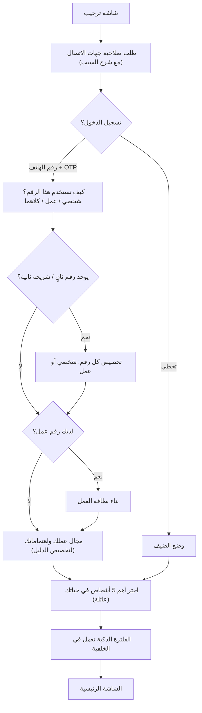
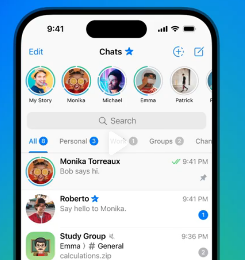
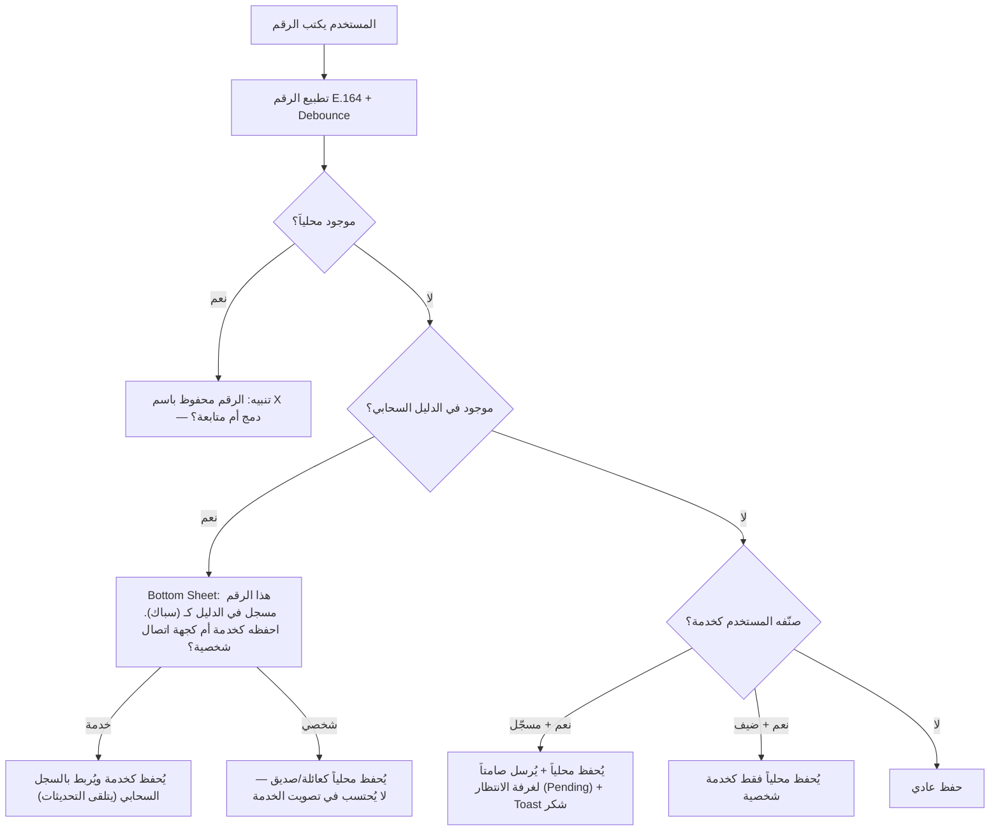
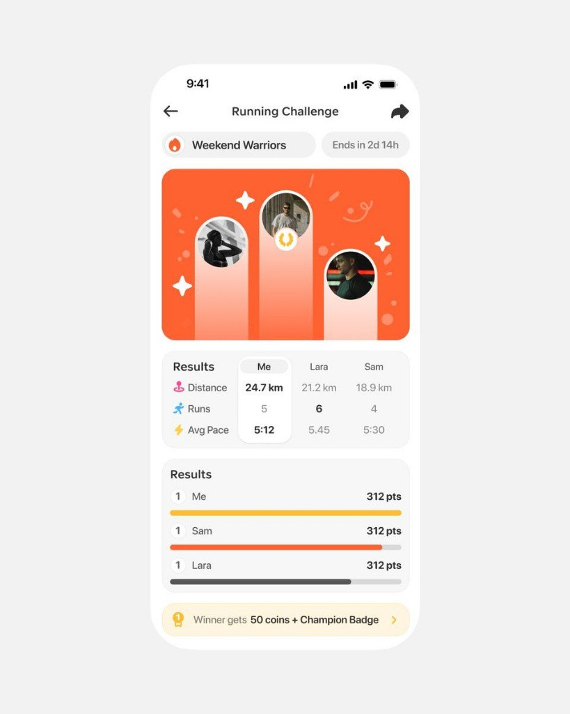
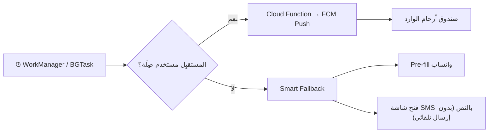
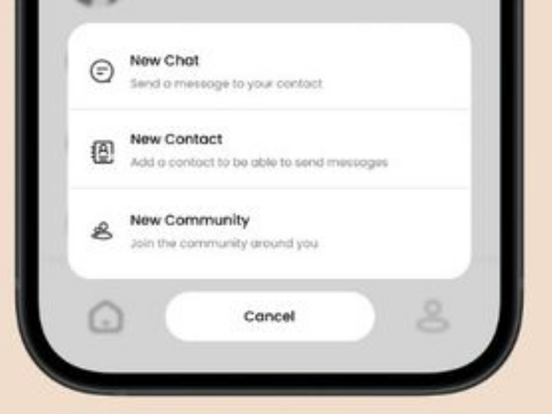
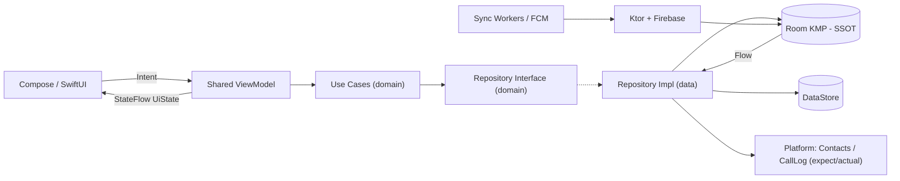
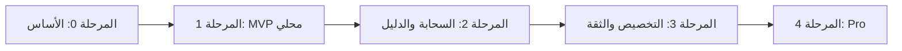

# 📱 صِلَة (Sila) — مستند متطلبات المنتج والمخطط التقني الشامل

> **الإصدار:** 1.0 — **الحالة:** جاهز لبدء التنفيذ
> **الرؤية:** تطبيق جهات اتصال ذكي وبسيط يسد فجوة حقيقية: ينظّم "مقبرة الأرقام"، ويضمن أن أرقام الخدمات تعمل دائماً، ويُذكّر المستخدم بصلة الرحم — بأقل عدد ممكن من النقرات (Zero Friction).

---

## فهرس المحتويات

1. [المشكلة والحل](#1-المشكلة-والحل)
2. [أنواع المستخدمين وحالات الحساب](#2-أنواع-المستخدمين-وحالات-الحساب)
3. [التهيئة الأولى والبطاقة التعريفية (Onboarding)](#3-التهيئة-الأولى-والبطاقة-التعريفية-onboarding)
4. [الصفحة 1: جهات الاتصال](#4-الصفحة-1-جهات-الاتصال)
5. [صفحة تفاصيل جهة الاتصال](#5-صفحة-تفاصيل-جهة-الاتصال)
6. [صفحة الإضافة والتعديل](#6-صفحة-الإضافة-والتعديل)
7. [دمج الأسماء المكررة](#7-دمج-الأسماء-المكررة)
8. [الفلترة والتصنيف الذكي للأرقام القديمة](#8-الفلترة-والتصنيف-الذكي-للأرقام-القديمة)
9. [الصفحة 2: دليل الخدمات الحي](#9-الصفحة-2-دليل-الخدمات-الحي)
10. [الصفحة 3: أرحام وشجرة العائلة](#10-الصفحة-3-أرحام-وشجرة-العائلة)
11. [النغمات المخصصة](#11-النغمات-المخصصة)
12. [التفضيلات والإعدادات](#12-التفضيلات-والإعدادات)
13. [نظام التصميم (Design System)](#13-نظام-التصميم-design-system)
14. [المعمارية التقنية](#14-المعمارية-التقنية)
15. [حزمة التقنيات (Tech Stack)](#15-حزمة-التقنيات-tech-stack)
16. [نماذج البيانات](#16-نماذج-البيانات)
17. [الخلفية السحابية (Firebase)](#17-الخلفية-السحابية-firebase)
18. [الصلاحيات وقيود الأنظمة](#18-الصلاحيات-وقيود-الأنظمة)
19. [الأمان والخصوصية](#19-الأمان-والخصوصية)
20. [النسخة الاحترافية المستقبلية (Pro)](#20-النسخة-الاحترافية-المستقبلية-pro)
21. [خطة التنفيذ على مراحل](#21-خطة-التنفيذ-على-مراحل)
22. [قرارات مفتوحة ومخاطر](#22-قرارات-مفتوحة-ومخاطر)

---

## 1. المشكلة والحل

| المشكلة | الحل في "صِلَة" |
|---|---|
| قائمة الأسماء عشوائية بلا تصنيف، والبحث بطيء | تصنيف سريع (عائلة، أصدقاء، عمل، خدمات، طوارئ) + إضافة ذكية تفرض التصنيف + فلترة آلية للأرقام القديمة |
| أرقام الخدمات (صيدلية، سباك، مطعم) تتغير ولا يعلم المستخدم | دليل خدمات سحابي حي يتحدث تلقائياً عند الجميع |
| ننسى الاتصال بالأقارب والأصدقاء | "أرحام": تتبع صامت لآخر اتصال وتنبيهات حسب وتيرة يحددها المستخدم |
| لا نعرف شجرة العائلة وصلات القرابة | شجرة عائلة مبسطة مبنية على وسوم القرابة |
| أسماء مكررة وفوضى | دمج المكرر بضغطة واحدة |

**مبدأ المنتج:** تطبيق بسيط، كل ميزة تحل مشكلة واحدة بشكل مباشر، ولا يفتقر لأي ميزة قياسية موجودة في تطبيقات المنافسين (Google Contacts / Apple Contacts / Truecaller).

---

## 2. أنواع المستخدمين وحالات الحساب

| الحالة | الوصف | الصلاحيات |
|---|---|---|
| **ضيف (Guest)** | تخطى التسجيل | كل ميزات جهات الاتصال وأرحام (محلية بالكامل) + **تصفح الدليل السحابي العام والاتصال منه (قراءة فقط)** |
| **مستخدم مسجّل (Basic)** | سجّل برقم الهاتف + OTP | كل ما سبق + التقييم + المساهمة بأرقام خدمية للعامة + إنشاء بطاقة تعريفية + تخصيص الدليل حسب المهنة |
| **صاحب خدمة (Provider)** | مسجّل وأنشأ بطاقة عمل | رقمه يظهر في الدليل كـ **موثق ✔** تلقائياً (لأن OTP أثبت ملكيته للرقم) |
| **احترافي (Pro)** — مستقبلي | اشتراك مدفوع | لوحة تحكم وإحصائيات (انظر [القسم 20](#20-النسخة-الاحترافية-المستقبلية-pro)) |

**نقاط التحويل للتسجيل (Conversion Triggers / Login Walls)** — لا نحجب المحتوى، بل الإجراءات التفاعلية:

- عند محاولة **التقييم** بعد مكالمة خدمية: *"صوتك يبني مجتمعاً موثوقاً! سجّل مجاناً لإضافة تقييمك."*
- عند محاولة **مشاركة رقم خدمي للعامة**: *"شارك هذا الرقم مع آلاف المستخدمين عبر إنشاء حساب سريع."*
- زر **"أضف نشاطك التجاري/الخدمي للدليل"** ← شاشة التسجيل مباشرة.
- شريط سفلي لطيف في صفحة الدليل: *"سجّل مجاناً لإضافة الخدمات والتقييم"*.

---

## 3. التهيئة الأولى والبطاقة التعريفية (Onboarding)

خطوات متسلسلة (Stepper) سريعة، **كل خطوة قابلة للتخطي**:



### 3.1 البطاقة التعريفية (Digital Profile)

| الحقل | ملاحظات |
|---|---|
| الأرقام | قائمة أرقام، لكل رقم نوع: `PERSONAL` / `WORK` / `BOTH` |
| الاسم المعروض | |
| الصورة | |
| **بطاقة العمل** (لأرقام WORK/BOTH): | |
| ├ نوع الخدمة / المهنة | من قائمة تصنيفات الدليل (طبيب، سباك، تاجر جملة…) |
| ├ اسم النشاط | مثال: "ورشة الأمانة" |
| ├ النطاق الجغرافي | المدينة/الحي + موقع اختياري (GeoPoint) |
| ├ أوقات العمل | مثال: 9 ص – 5 م، أيام العمل |
| └ وصف مختصر | |
| **مجال العمل/الاهتمامات** | يتحول إلى وسوم (`retail`, `food_beverage`, `wholesale`…) لتخصيص الدليل |

### 3.2 المشاركة السريعة (QR / Link)
- تحويل البطاقة إلى **QR Code** أو رابط عميق (Deep Link).
- عند المسح: يُحفظ الرقم فوراً عند الطرف الآخر **بالتصنيف الذي حدده صاحب البطاقة** (عمل أو شخصي).
- يمكن مشاركة بطاقة خدمة (صيدلية، رقم طوارئ) عبر واتساب برابط يفتح التطبيق على البطاقة مع خيار الحفظ.

> [!NOTE]
> **الشريحة الثانية:** على أندرويد يمكن اكتشافها عبر `SubscriptionManager` (يتطلب `READ_PHONE_STATE`)، وغالباً لا يُرجع النظام الرقم نفسه فيُطلب من المستخدم إدخاله. على iOS لا يمكن قراءة الأرقام إطلاقاً، فيُدخلها المستخدم يدوياً.

---

## 4. الصفحة 1: جهات الاتصال

**المرجع البصري:** صف المفضلة الدائري + تبويبات بعدادات (مستوحى من تيليجرام).



### 4.1 مكونات الشاشة (من الأعلى للأسفل)

1. **شريط علوي:** العنوان "جهات الاتصال" + زر تعديل/تحديد متعدد + أيقونة الإعدادات.
2. **صف المفضلة (Favorites Row):** دوائر أفقية قابلة للتمرير لجهات الاتصال المميزة بنجمة. حلقة ملونة حول الصورة تعكس حالة "أرحام" إن كان الشخص من العائلة (أحمر/أصفر/أخضر). نقرة = اتصال سريع، ضغطة مطولة = خيارات.
3. **شريط البحث:** بحث فوري (FTS) بالاسم، الرقم، الكنية، الشركة، المسمى الوظيفي، الوسوم.
4. **تبويبات/Chips التصنيف مع عدادات:** `الكل 8` · `عائلة 3` · `أصدقاء` · `عمل 1` · `خدمات` · `طوارئ` · `غير مصنف`. الانتقال بين التبويبات بحركة Fade/Slide.
5. **قائمة الأسماء:** صورة أو حرف أول + الاسم + سطر فرعي (صلة القرابة/المهنة/آخر اتصال) + **أيقونة صغيرة ملونة بالتصنيف** + زر اتصال سريع. فهرس أبجدي جانبي (عربي/إنجليزي).
6. **بطاقة اقتراحات (عند الحاجة):** "وجدنا 15 رقم خدمة، انقلهم لقسم الخدمات؟" / "لديك 6 أسماء مكررة، ادمجها؟"
7. **زر الإضافة الذكي (Smart FAB +):** يفتح **Bottom Sheet** موحد بخيارات:
   - 👤 **جهة اتصال جديدة** — صديق، زميل، أو أي شخص
   - 👨‍👩‍👧 **فرد من العائلة** — مع ضبط القرابة ووتيرة التواصل
   - 🔧 **رقم خدمي** — سباك، صيدلية، أو نشاط تجاري
   - 📷 **مسح بطاقة QR**
8. **شريط التنقل السفلي الموحد** (انظر [13.3](#133-شريط-التنقل-السفلي-الموحد)).

### 4.2 قواعد السلوك
- **الحساب المصدر:** عرض جهات الاتصال من كل الحسابات (الهاتف، Google، SIM…) مع إمكانية الفلترة بالحساب.
- **التحديد المتعدد:** تصنيف جماعي، حذف جماعي، مشاركة جماعية، دمج.
- **سحب الصف (Swipe):** يمين = اتصال، يسار = رسالة (قابل للتخصيص من التفضيلات).

---

## 5. صفحة تفاصيل جهة الاتصال

> انتقال **Shared Element**: صورة/بطاقة جهة الاتصال تتمدد من القائمة لتصبح رأس صفحة التفاصيل.

### 5.1 بطاقة الاتصال (Calling Card)
- الصورة، الاسم الكامل، الكنية، المسمى الوظيفي والشركة.
- شارة التصنيف + صلة القرابة (إن وجدت) + شارة التوثيق (للخدمات).
- أزرار سريعة: **اتصال** · **رسالة** · **فيديو** · **بريد**.
- عند تعدد الأرقام: اختيار الرقم الافتراضي، وعرض نوع كل رقم (جوال، عمل، منزل) والشريحة المفضلة للاتصال.

### 5.2 التطبيقات المرتبطة (Connected Apps)
- اكتشاف وعرض اختصارات WhatsApp / Telegram / Signal / Viber… للمحادثة أو الاتصال مباشرة.
- أندرويد: قراءة `RawContacts` الخاصة بحسابات هذه التطبيقات من Contacts Provider (MIME types الخاصة بكل تطبيق).
- iOS: روابط مخصصة (`whatsapp://`, `tg://`) عبر `LSApplicationQueriesSchemes`.

### 5.3 سجل التفاعل (Recent History)
- مكالمات صادرة/واردة/فائتة لهذا الرقم تحديداً مع المدة والتاريخ.
- لجهات "أرحام": مؤشر الوتيرة ("الهدف: أسبوعياً — آخر اتصال قبل 9 أيام").
- لجهات الخدمات: تقييمك السابق إن وجد.

### 5.4 إدارة جهة الاتصال (عبر زر "المزيد" ← Bottom Sheet)
| الإجراء | الوصف |
|---|---|
| ⭐ إضافة/إزالة من المفضلة | تظهر في صف المفضلة |
| 🔗 مشاركة جهة الاتصال | vCard / نص / QR |
| 🏠 إضافة إلى الشاشة الرئيسية | Pinned Shortcut (أندرويد) |
| 🔄 نقل إلى حساب آخر | من الهاتف إلى Google أو العكس |
| 🔔 النغمة المخصصة | انظر [القسم 11](#11-النغمات-المخصصة) |
| 📞 تحويل إلى البريد الصوتي | `SEND_TO_VOICEMAIL` (أندرويد) |
| 🚫 حظر الرقم | `BlockedNumberContract` (أندرويد) / Call Directory Extension (iOS) |
| 🗂 تغيير التصنيف | |
| 👨‍👩‍👧 إعدادات أرحام | القرابة، الوتيرة، المناسبات |
| 🗑 حذف | مع تأكيد وإمكانية التراجع (Undo Snackbar) |

### 5.5 إعدادات جهة الاتصال (Contact Settings)
النغمة، البريد الصوتي، الحظر، الحساب المرتبط، استبعاد من الفلترة الذكية، استبعاد من الدمج.

---

## 6. صفحة الإضافة والتعديل

**الهيكل:** المعلومات الأساسية في الأعلى + زر **"إظهار المزيد" (Expand)** لكشف الحقول المتقدمة، منعاً لتشتيت المستخدم البسيط. كل مجموعة حقول قابلة للطي/التوسيع.

### 6.1 الصورة الرمزية
التقاط صورة، اختيار من المعرض، قص (Crop)، أو لون + حرف افتراضي.

### 6.2 الحقول

| المجموعة | الحقول |
|---|---|
| **التصنيف (إلزامي بلطف)** | عائلة / أصدقاء / عمل / خدمات / طوارئ — يظهر كـ Chips أعلى النموذج |
| **الاسم** | البادئة (Prefix: د.، م.) · الاسم الأول · الاسم الأوسط · اسم العائلة · اللاحقة (Suffix) · الكنية/اسم الشهرة (Nickname) · **حفظ باسم (File as)** · النطق الصوتي (Phonetic) |
| **الأرقام** | رقم + نوع (جوال، عمل، منزل، فاكس، مخصص) — عدة أرقام، وتعيين رقم افتراضي |
| **البريد الإلكتروني** | بريد + نوع — متعدد |
| **المعلومات المهنية** | الشركة · القسم · **المسمى الوظيفي (متعدد)** |
| **العناوين** | عنوان + نوع — متعدد |
| **التواريخ الهامة** | عيد ميلاد · ذكرى زواج · مخصص — **ترتبط تلقائياً بأرحام إن كانت جهة الاتصال عائلة** |
| **العلاقات** | (أب، أم، زوج…) — ترتبط بشجرة العائلة |
| **المواقع والروابط** | Website · حسابات تواصل اجتماعي |
| **الملاحظات** | نص حر |
| **حقول مخصصة (Custom Fields)** | اسم الحقل + القيمة — غير محدودة |
| **الحساب** | حفظ في: الهاتف / Google / SIM |
| **النغمة** | انظر [القسم 11](#11-النغمات-المخصصة) |
| **خاص بالخدمات** | نوع الخدمة، أوقات العمل، مشاركة مع الدليل العام (للمسجلين) |
| **خاص بالعائلة** | صلة القرابة، وتيرة التواصل |

### 6.3 فحص الرقم أثناء الإضافة (منطق الخدمات)



---

## 7. دمج الأسماء المكررة

- **الفحص:** محلي بالكامل، دوري (WorkManager) + عند الطلب.
- **معايير الاكتشاف (بترتيب الثقة):**
  1. رقم متطابق بعد التطبيع (E.164) ← ثقة عالية.
  2. بريد إلكتروني متطابق ← ثقة عالية.
  3. اسم متطابق بعد التطبيع العربي (إزالة التشكيل، توحيد أ/إ/آ ← ا، ة ← ه، ى ← ي) ← ثقة متوسطة.
  4. أسماء متشابهة (Levenshtein / Jaro-Winkler فوق عتبة) ← اقتراح فقط.
- **الواجهة:** بطاقة اقتراح في الصفحة الرئيسية ← شاشة "المكررات" تعرض كل مجموعة مع معاينة النتيجة بعد الدمج ← **دمج بضغطة واحدة** أو "دمج الكل" لمجموعات الثقة العالية، أو "ليست مكررة" (لا تُقترح مجدداً).
- **قواعد الدمج:** الاحتفاظ بكل الأرقام والبريد والحقول دون تكرار، اختيار الاسم الأطول/الأكمل، الاحتفاظ بالتصنيف وبيانات أرحام للسجل الأقدم، مع إمكانية **التراجع (Undo)**.
- أندرويد: استخدام `AggregationExceptions` (ربط RawContacts) بدلاً من الحذف كلما أمكن. iOS: `CNContactStore` (الدمج يدوي بحذف وإعادة كتابة، مع حفظ نسخة احتياطية محلية قبل التنفيذ).

---

## 8. الفلترة والتصنيف الذكي للأرقام القديمة

- **قاموس كلمات مفتاحية** (عربي + إنجليزي + عامية) لكل تصنيف، قابل للتحديث من السحابة (Remote Config):
  - خدمات: دكتور، د.، صيدلية، سباك، كهربائي، نجار، مطعم، مركز، شركة، ورشة، م.، Dr، Pharmacy…
  - عائلة: عمي، خالي، عمتي، خالتي، أمي، أبي، بابا، ماما، جدي، تيتا، أخي، ابن عمي…
  - طوارئ: إسعاف، شرطة، مطافي، طوارئ…
- **إشارات إضافية:** الرقم موجود في الدليل السحابي ← خدمة محتملة؛ الرقم أرضي/مختصر (مثل 19xxx) ← خدمة/طوارئ؛ وجود حقل "الشركة" ← عمل.
- **التشغيل:** في الخلفية بعد Onboarding، ثم إشعار/بطاقة: *"وجدنا 15 رقم خدمة، هل تريد نقلهم لقسم الخدمات؟"* ← شاشة مراجعة بقوائم مقترحة مع تحديد/إلغاء تحديد ← تأكيد.
- **التصنيف التدريجي (Progressive):** عند الاتصال برقم غير مصنف، يظهر اقتراح خفيف بعد المكالمة: "صنّف أحمد؟ [عائلة] [صديق] [عمل] [خدمة]".
- **التعلم المحلي:** حفظ اختيارات المستخدم لتحسين الاقتراحات (دون رفعها للسيرفر).

---

## 9. الصفحة 2: دليل الخدمات الحي

### 9.1 مكونات الشاشة
1. **شريط بحث:** "البحث عن خدمة… (مثلاً: سباك)".
2. **Chips مخصصة حسب مهنة المستخدم** (B2B/B2C — انظر 9.6).
3. **شبكة تصنيفات (Grid):** صيدليات، صيانة منزلية، مطاعم، طوارئ، تجار جملة…
4. **بطاقات الخدمات:** الاسم + المهنة + المسافة + الحالة (متاح الآن/مغلق) + **شارة المستوى** + **مؤشر الثقة** + **زر اتصال مباشر على البطاقة (One-Tap Call)**.
5. **قسم "خدماتي":** الأرقام الخدمية التي حفظها المستخدم (بما فيها الشخصية غير العامة).
6. **زر "أضف نشاطك للدليل"** + شريط تسجيل للضيوف.

### 9.2 مستويات التوثيق (Badges)

| المستوى | الشرط | الظهور | الشارة |
|---|---|---|---|
| **شخصي** | أضافه مستخدم واحد كخدمة | لصاحبه فقط | لا شيء |
| **مجتمعي** | أضافه **N مستخدمين مختلفين** (مقترح: 5) كخدمة بنفس المهنة، **وليس** كعائلة/أصدقاء | للعامة | 🟠 مجتمعي (غير موثق) |
| **موثق** | تحقق الإدارة (مراجعة/اتصال) **أو** صاحب الرقم أنشأ بطاقة عمل وأثبت ملكيته بـ OTP | للعامة | 🟢 موثق ✔ |

> [!IMPORTANT]
> **حماية الخصوصية:** أي رقم يحفظه أحد المستخدمين كعائلة/صديق **لا يُحتسب أبداً** كتصويت خدمي، ولا يُرفع للسيرفر. إن كان رقم "الخال السباك" محفوظاً عند أقاربه كعائلة فلن يظهر للعامة إلا إن صنّفه عدد كافٍ من غير الأقارب كخدمة.

### 9.3 تحديث الأرقام (Live Updates)
- عند تغيير صاحب الخدمة لرقمه من بطاقته، أو اعتماد بلاغ "رقم لا يعمل + الرقم الجديد" من عدة مستخدمين/الإدارة ← يتحدث السجل السحابي.
- يصل التحديث عبر **FCM Data Message صامتة** ← Worker يجلب التغييرات ← يحدّث Room ← تتحدث الواجهة تلقائياً.
- **اختياري:** تحديث جهة الاتصال الأصلية في دفتر الهاتف أيضاً (بعد موافقة المستخدم مرة واحدة من التفضيلات).
- زر **"الإبلاغ عن رقم لا يعمل"** في بطاقة الخدمة (للمسجلين).

### 9.4 التقييم بعد المكالمة الأولى
- **الشرط:** مكالمة صادرة لرقم خدمي ← **ليس** من أرحام/العائلة ← مدة ≥ 30 ثانية ← لم يُقيّمه المستخدم من قبل.
- **الواجهة:** إشعار تفاعلي أو Bottom Sheet سريع بعد انتهاء المكالمة: *"كيف كانت تجربتك مع سباك أبو محمد؟"* ← **🤩 ممتاز · 🙂 عادي · 😞 سيء** (نقرة واحدة، تعليق اختياري).
- **الضيف:** يرى السؤال، وعند النقر يظهر Login Wall.

### 9.5 درجة الثقة (Trust Score) بدلاً من التقييم المتكرر
- إذا عاد المستخدم للاتصال بنفس الخدمة (مثلاً 3 مرات خلال 30 يوماً، خاصة من صفحة الدليل) ← **لا يظهر تقييم مجدداً**، بل يُرفع "مؤشر الثقة" لهذا الرقم (أفعال المستخدمين أصدق من تقييماتهم).
- **العرض:** 🔥 (طلب عالٍ في منطقتك) · *"مُفضل لدى 50 مستخدم"* · *"نسبة العودة 85%"*.

**معادلة مقترحة (تُحسب في Cloud Functions):**

$$
\text{Trust} = w_1 \cdot \text{RetentionRate} + w_2 \cdot \overline{\text{Rating}} + w_3 \cdot \log(1 + \text{UniqueCallers}) + \text{VerifiedBonus}
$$

حيث كل مساهمة موزونة بـ **وزن الحساب** (عمر الحساب ونشاطه).

### 9.6 منع التلاعب (Fraud Prevention)
- لا تقييم بدون مكالمة حقيقية مسجّلة (≥ 30 ثانية) لنفس الرقم.
- **Rate Limiting:** مكالمة واحدة فقط تُحتسب لكل (حساب، رقم، يوم).
- الحسابات الجديدة وزنها أقل؛ صاحب الخدمة لا يستطيع تقييم نفسه.
- كشف الأنماط الشاذة (حسابات عديدة جديدة تصوت لنفس الرقم) في Cloud Functions.
- **Firebase App Check** لمنع الطلبات من خارج التطبيق.

### 9.7 التخصيص حسب المهنة (B2B / B2C) والنطاق الجغرافي
- **Smart Matching (منطق التبعية):** جدول علاقات بين المهن يحدد ما يحتاجه كل نشاط:
  - تاجر تجزئة ← تجار جملة، مصانع، موردون، شحن.
  - تاجر جملة ← شركات نقل، مندوبو توزيع.
  - مستخدم عادي ← صيدلية، سباك، كهربائي، مطاعم.
- الـ Chips العلوية وترتيب الشبكة **ديناميكية** حسب وسوم المستخدم؛ الخدمات العامة تُجمع في تبويب "خدمات عامة".
- **Dual Geo-Fencing:**
  - خدمات يومية: نطاق ضيق (2–5 كم، قابل للتعديل).
  - B2B: نطاق أوسع تلقائياً (المدينة/المحافظة/المراكز التجارية الكبرى — مثال: تاجر في السويس يرى موردي العتبة ورمسيس).
- **تقنياً:** Geohash على المستندات + استعلامات نطاق (مكتبة GeoFire-style) أو Algolia/Typesense لاحقاً للبحث النصي والجغرافي.

### 9.8 سجل النزاعات (Dispute Log)

> [!NOTE]
> بديل عن تسجيل المكالمات (ممنوع قانونياً في معظم الدول العربية + محظور تقنياً في Android 12+ و iOS).

- **الغرض:** توفير وسيلة لتوثيق أي نزاع مع مزود خدمة بشكل نصي + مرفقات.
- **الوصول:** زر "📝 توثيق نزاع" في صفحة تفاصيل الخدمة (للمسجلين فقط).
- **محتوى السجل:**
  - نص وصف المشكلة (حتى 500 حرف).
  - صور/لقطات شاشة (حتى 3 صور، WebP ≤ 256px ≤ 20KB).
  - تاريخ ووقت الإنشاء (تلقائي).
  - حالة: `OPEN` → `RESOLVED` → `ARCHIVED`.
- **التخزين:**
  - محلياً في Room: `dispute_logs` — متاح بدون إنترنت.
  - سحابياً في Firestore: `disputes/{disputeId}` — يُرسل عبر Outbox عند الاتصال.
  - **الصور:** Firebase Storage (مسار: `disputes/{disputeId}/img_{n}.webp`) مع TTL 14 يوماً بعد الأرشفة.
- **الخصوصية:** السجل خاص بالمستخدم فقط — لا يظهر لمزود الخدمة ولا للمستخدمين الآخرين.
- **الأرشفة التلقائية:** بعد 90 يوماً من `RESOLVED` أو 180 يوماً من `OPEN` بدون تحديث.
- **مستقبلاً (Pro):** إمكانية مشاركة السجل مع إدارة التطبيق كبلاغ مدعوم بالأدلة.

### 9.9 وضع الضيف في الدليل
- **قراءة كاملة** للدليل العام (مجتمعي + موثق) والاتصال المباشر — كأقوى "طُعم" لإثبات قيمة التطبيق.
- **لا كتابة:** لا تقييم، لا مساهمة عامة، لا بلاغات (تظهر Login Walls).
- التخصيص حسب المهنة غير متاح للضيف (يرى الدليل الافتراضي حسب الموقع فقط).

---

## 10. الصفحة 3: أرحام وشجرة العائلة

**المرجع البصري:** منصة تتويج علوية + بطاقة إحصائيات + قائمة مرقمة نظيفة.

| المنصة والإحصائيات | القائمة المرقمة |
|---|---|
|  |  |

### 10.1 الجزء العلوي: لوحة صلة الرحم (Connection Dashboard)
- **عنوان + فترة:** "أرحام" + Chip الفترة (هذا الأسبوع / هذا الشهر) + "ينتهي خلال 2 يوم".
- **المنصة البرتقالية (Podium):** أكثر 3 أقارب تواصلت معهم في الفترة — تعزيز إيجابي (الأعلى في المنتصف مع إكليل).
- **بطاقة الإحصائيات (Stats):** إجمالي المكالمات العائلية · أطول مكالمة · عدد الأقارب الذين تواصلت معهم · **نسبة تحقيق أهداف التواصل**.
- **شريط التقدم:** نسبة إنجاز أهداف الفترة.
- **بطاقة تحفيزية سفلية (اختيارية):** "تواصلت مع 80% من عائلتك هذا الشهر 🌿" أو تذكير بمناسبة قادمة (عيد ميلاد).
- **تبويبان:** `التنبيهات والوصال` | `شجرة العائلة`.

### 10.2 الجزء السفلي: قائمة الأقارب حسب الأولوية

| العنصر | السلوك |
|---|---|
| **الرقم (01، 02، 03…)** | الأولوية — 01 هو الأطول انقطاعاً نسبةً لوتيرته المستهدفة |
| **الاسم** | بخط بارز (مثلاً: العم أحمد) |
| **النص الفرعي** | حالة التواصل: "مر 20 يوماً منذ آخر اتصال" / "الهدف: اتصال أسبوعي" |
| **الأيقونة الجانبية** | زر اتصال 📞 **ملون حسب الحالة**: 🔴 تجاوز المدة · 🟡 اقترب الموعد · 🟢 تم التواصل مؤخراً |

**حساب الأولوية:**

$$
\text{Urgency} = \frac{\text{الأيام منذ آخر اتصال}}{\text{الوتيرة المستهدفة بالأيام}}
$$

- `Urgency ≥ 1.0` ← 🔴 أحمر (حان وقت الوصال)
- `0.7 ≤ Urgency < 1.0` ← 🟡 أصفر (قريباً)
- `Urgency < 0.7` ← 🟢 أخضر (تم الوصال)

### 10.3 التتبع الصامت (Zero-Friction Tracking)
- مهمة يومية في الخلفية + عند فتح التطبيق: قراءة سجل المكالمات محلياً.
- **شرط المكالمة الناجحة:** صادرة أو واردة، ومدتها > 0 ثانية (تم الرد).
- عند تحقق الشرط لرقم من أرحام ← تحديث `lastContactedAt` في Room ← تتغير الحالة تلقائياً.
- **بدون أي إنترنت** — هذا القسم لا يتصل بالسيرفر إطلاقاً.

> [!WARNING]
> **iOS لا يسمح بقراءة سجل المكالمات.** البديل على iOS: (1) تسجيل المكالمات التي تبدأ من داخل التطبيق، (2) `CXCallObserver` أثناء عمل التطبيق، (3) سؤال خفيف عند العودة للتطبيق: "هل تحدثت مع عمك أحمد؟ ✔". وعلى أندرويد انظر تحذير سياسة Google Play في [القسم 18](#18-الصلاحيات-وقيود-الأنظمة).

### 10.4 إعداد بطاقة القريب (Kinship Setup) — Bottom Sheet
- **صلة القرابة:** أب، أم، جد، جدة، أخ، أخت، ابن، ابنة، زوج/زوجة، عم، عمة، خال، خالة، ابن/ابنة عم، ابن/ابنة خال، صديق مقرب، مخصص.
- **الوتيرة:** يومياً · أسبوعياً · كل أسبوعين · شهرياً · في المناسبات فقط (مع وصف تحت كل خيار).
- **المناسبات:** عيد ميلاد، ذكرى — إشعار استثنائي في اليوم.
- **إيقاف مؤقت:** (سفر، ظروف) دون حذف الإعداد.

### 10.5 الإشعارات
- إشعارات محلية في **أوقات الفراغ المتوقعة** (المساء، بعد صلاة الجمعة) وتحترم **أوقات الهدوء** من التفضيلات.
- تجميع: إشعار واحد يومي بحد أقصى: *"عمك أحمد يفتقدك، مر 30 يوماً منذ آخر اتصال"* مع أزرار: **اتصال الآن** · **ذكّرني غداً**.
- صياغة لطيفة بلا إشعار بالذنب.

### 10.6 المكافأة البصرية (Micro-interactions)
- عند الاتصال بقريب من النطاق الأحمر والعودة للتطبيق: البطاقة تتحرك بسلاسة من الأحمر للأخضر + **Confetti** (Lottie) خفيف.
- تحديث المنصة والإحصائيات بحركة أرقام متصاعدة.

### 10.7 شجرة العائلة المبسطة
- **المنطق:** وسوم هرمية محلية بدون Graph Database — كل قريب له `relation` يُحوَّل إلى طبقة:
  - **الأصول:** الأجداد ← الآباء.
  - **المستخدم + الفروع:** الإخوة، الأبناء.
  - **الحواشي:** الأعمام/العمات (جهة الأب)، الأخوال/الخالات (جهة الأم)، وأبناؤهم.
- علاقات اختيارية بين الأقارب أنفسهم (`parentContactId`) لربط "ابن عمي" بـ "عمي".
- **الواجهة:** تبويب "شجرة العائلة" يعرض Tree Node View: دوائر بالصور/الحروف، الجد في الأعلى وخطوط تتفرع؛ تكبير/تصغير وتحريك (Pinch/Pan)؛ نقرة على أي دائرة = اتصال أو فتح البطاقة.
- **مستقبلاً (اختياري، بموافقة):** ربط الشجرة بين حسابات أفراد العائلة.

### 10.8 أتمتة الوصال (In-App Automation)

> [!NOTE]
> بديل عن أتمتة الرسائل النصية (SMS) — صلاحية `SEND_SMS` محظورة في Google Play إلا للتطبيقات الافتراضية.

**الفكرة:** جدولة رسائل داخلية أو رنات تلقائية للأقارب — تعمل **محلياً أولاً** (WorkManager / BGTaskScheduler) وتستخدم السحابة عند الاتصال بالإنترنت.

#### أنواع الأتمتة
| النوع | الآلية | ملاحظات |
|---|---|---|
| **رسالة داخلية (In-App Message)** | إشعار Push عبر FCM إن كان المستقبِل مستخدماً لصِلَة، وإلا Pre-fill واتساب/رسالة | لا يُرسل SMS تلقائياً — يفتح واجهة المستخدم فقط |
| **رنة تلقائية (Auto-Ring)** | `ACTION_CALL` (بصلاحية `CALL_PHONE`) في الوقت المحدد ← يرن ثم يُنهي بعد 15 ثانية إن لم يُرد | للتذكير فقط — ليس محادثة تلقائية |

#### الجدولة
- **التكرار:** يومياً · أسبوعياً · أيام محددة من الأسبوع · يوم محدد في الشهر · كل شهر · مرة واحدة (مخصص).
- **الوقت:** يحدده المستخدم (مع احترام أوقات الهدوء).
- **النص المخصص:** للرسائل الداخلية — يمكن تحرير نص مسبق: *"السلام عليكم يا خالتي، كيف حالك؟ 🌸"*.

#### التدفق (للرسائل الداخلية)


#### صندوق أرحام الوارد (Arham Inbox)
- يظهر كتبويب فرعي في شاشة أرحام: `التنبيهات والوصال` | `الرسائل` | `شجرة العائلة`.
- كل رسالة واردة: اسم المرسل + النص + الوقت + **ردود سريعة** (Quick Reactions): ❤️ 🤲 👍 😊.
- الرد السريع = إشعار Push للمرسل.
- بدون إنترنت: الرسائل تُحفظ محلياً وتُرسل عند الاتصال (Outbox).

#### التخزين
- Room: `scheduled_messages` (القواعد والجدول)، `arham_inbox` (الرسائل الواردة والصادرة).
- Firestore: `arham_messages/{messageId}` — مع TTL 30 يوماً.

### 10.9 رنين الطوارئ المتواصل (Emergency Ringing)

> [!CAUTION]
> **مقيّد بجهات اتصال الطوارئ فقط** (`category == EMERGENCY`) لمنع الاستخدام غير الأخلاقي (الإزعاج). يظهر تحذير واضح قبل التفعيل.

**الغرض:** في حالات الطوارئ الحقيقية، يستمر التطبيق في الاتصال بالرقم حتى يتم الرد.

#### السلوك
1. من صفحة تفاصيل جهة اتصال طوارئ ← زر "🚨 رنين طوارئ".
2. تحذير: *"ستواصل صِلَة الاتصال بهذا الرقم حتى يتم الرد. استخدم في الطوارئ فقط."* ← تأكيد.
3. **أندرويد:** حلقة `ACTION_CALL` → عند `IDLE` (بدون رد أو مشغول) → انتظار 5 ثوانٍ → إعادة الاتصال. يتوقف عند: الرد (مدة > 0) · ضغط "إيقاف" · 10 محاولات (قابلة للتعديل).
4. **iOS:** لا يمكن إجراء مكالمات برمجياً. البديل:
   - إرسال **Critical Alert** عبر FCM Data Message (يتطلب Critical Alerts Entitlement من Apple) — يُصدر صوتاً حتى في وضع "عدم الإزعاج".
   - إن كان المستقبِل مستخدم صِلَة: يتلقى إشعاراً حرجاً مع رسالة *"[اسم المتصل] يحاول الوصول إليك بشكل عاجل!"* + زر "اتصل به الآن".
   - إن لم يكن مستخدم صِلَة: الحلقة تعمل بفتح `tel:` URL متكرراً (يحتاج تأكيد المستخدم كل مرة).
5. **خيار الميكروفون:** يمكن تفعيل/تعطيل الميكروفون أثناء الرنين (لتسمع الرد دون الحاجة لمسك الهاتف).

#### القيود
- يعمل **فقط** مع جهات اتصال مصنفة كـ `EMERGENCY`.
- **Rate Limit:** 3 جلسات رنين كحد أقصى في 24 ساعة.
- يتطلب صلاحية `CALL_PHONE` (أندرويد).
- حالة الحظر (`isBlocked`): يتوقف فوراً مع إشعار.

---

## 11. النغمات المخصصة

- **نغمة لكل تصنيف:** (نغمة دافئة للعائلة، رسمية للعمل…) — تُطبّق على كل جهات الاتصال في التصنيف التي ليس لها نغمة فردية.
- **نغمة لجهة اتصال محددة:** من صفحة التفاصيل أو التعديل (تتغلب على نغمة التصنيف).
- **اختيار النغمة:** نغمات النظام عبر `RingtoneManager.ACTION_RINGTONE_PICKER` أو ملف صوتي من الجهاز.
- **أندرويد:** الكتابة في `ContactsContract.Contacts.CUSTOM_RINGTONE` لكل جهة اتصال (يتطلب `WRITE_CONTACTS`)؛ عند تغيير نغمة تصنيف يُطبّقها Worker على كل الأعضاء.

> [!WARNING]
> **iOS لا يوفر API لتعيين نغمة جهة اتصال برمجياً.** على iOS تُعرض الميزة كإرشاد يفتح بطاقة جهة الاتصال في تطبيق Contacts، أو تُخفى.

---

## 12. التفضيلات والإعدادات

> **مرجع التصميم:** [settings-grouped-clean.jpg](design-references/settings-grouped-clean.jpg) — تنظيم العناصر في مجموعات بعناوين أقسام، عرض القيمة الحالية inline، ألوان هادئة ومريحة للعين.

| المجموعة | الإعدادات |
|---|---|
| **المظهر** | فاتح / داكن / حسب النظام · اللغة (عربي/English) · حجم الخط |
| **عام** | الشاشة الافتراضية عند الفتح (جهات الاتصال / الدليل / أرحام) · ترتيب الأسماء (الاسم الأول/الأخير) · عرض الاسم (File as) · الحسابات المعروضة · إجراءات السحب (Swipe) |
| **أرحام** | تفعيل/تعطيل الإشعارات · **أوقات الهدوء (Quiet Hours)** · الوقت المفضل للتذكير · الحد الأقصى للإشعارات يومياً · فترة لوحة الإنجاز (أسبوع/شهر) · إظهار الاحتفال (Confetti) |
| **الدليل** | **النطاق الجغرافي للبحث (كم)** · المدينة الافتراضية · **تفعيل/تعطيل التقييم السريع بعد المكالمات** · تحديث أرقام الخدمات في دفتر الهاتف تلقائياً |
| **التنظيم** | الفلترة الذكية التلقائية · فحص المكررات الدوري · قاموس الكلمات المفتاحية المخصص |
| **النغمات** | نغمة لكل تصنيف |
| **الحساب** | البطاقة التعريفية · مجال العمل · رمز QR · تسجيل الخروج · حذف الحساب وبياناته السحابية |
| **الخصوصية** | إدارة الصلاحيات · سياسة الخصوصية · تصدير/نسخ احتياطي محلي للتصنيفات وبيانات أرحام · إرسال تقارير الأعطال |
| **حول** | الإصدار · تقييم التطبيق · التواصل |

التخزين: **DataStore KMP** (Preferences/Proto).

---

## 13. نظام التصميم (Design System)

### 13.1 مبادئ التصميم البصري
- **ألوان هادئة ومريحة للعين:** تباين واضح بدون إجهاد — خلفيات كريمية دافئة (`#F7F5F2`)، بطاقات بيضاء، نصوص داكنة، ونصوص فرعية رمادية ناعمة. الألوان الزاهية (الأخضر، البرتقالي، الأزرق) تُستخدم بحذر في الشارات والأيقونات والـ Chips فقط، وليس في المساحات الكبيرة.
- **تنظيم العناصر بعناوين أقسام:** كل شاشة تجمع العناصر المتعلقة في مجموعات بعنوان رمادي فاتح (Section Header)، داخل بطاقات Surface بزوايا دائرية. هذا يسرّع الفحص البصري (Scannability) ويقلل الحِمل المعرفي. **المرجع:** [settings-grouped-clean.jpg](design-references/settings-grouped-clean.jpg).
- **عرض القيمة الحالية Inline:** أي إعداد قابل للتغيير يعرض حالته الحالية على الطرف الآخر من السطر (مثل: `Light ›`، `العربية ›`، Toggle ON/OFF). هذا يوفر معلومات فورية بدون نقرات.
- **Whitespace سخي:** مسافات واضحة بين المجموعات (24dp) وداخل العناصر (14dp padding عمودي) — لا تكديس.
- **أيقونات خطية رفيعة (Outline):** بدون ألوان صاخبة — للتعرف البصري السريع فقط.
- **صفحة البروفايل المنظمة:** نفس أسلوب التجميع في الإعدادات يُطبق على صفحة البروفايل — رأس بصورة واسم وبريد، ثم مجموعات (الحساب / التفضيلات / الدعم) بعناوين أقسام. **المرجع:** [profile-grouped-redesign.png](design-references/profile-grouped-redesign.png).

### 13.2 الهوية البصرية (الألوان والخطوط)
- **الألوان:** أخضر زمردي (الأساسي — الخدمات والتوثيق)، برتقالي غروب (أرحام والمنصة)، أزرق داكن (النصوص والعمل)، مع تدرجات محايدة دافئة للخلفيات.
- **ألوان التصنيفات:** عائلة 🔴 أحمر · أصدقاء 🟠 برتقالي · عمل 🔵 أزرق · خدمات 🟢 أخضر · طوارئ 🟣 بنفسجي · غير مصنف ⚪ رمادي.
- **الخط:** خط عربي حديث يدعم اللاتيني (مثل IBM Plex Sans Arabic / Cairo / Tajawal).
- **الاتجاه:** **RTL أولاً** مع دعم كامل لـ LTR.
- **الزوايا:** دائرية ناعمة (16–28dp للبطاقات والـ Sheets).
- أندرويد: Material 3 + Dynamic Color اختياري. iOS: مكونات SwiftUI الأصلية بنفس الألوان.

### 13.3 النوافذ المنبثقة (Dialogs & Bottom Sheets) — المعيار الموحد



- **الحاوية:** بطاقة بيضاء عائمة بحواف دائرية ناعمة جداً، فوق الشاشة مع تظليل خفيف (Scrim) للخلفية التي تبقى مرئية.
- **كل خيار:** أيقونة خطية رفيعة (Outline) على البداية (يمين في RTL) + **عنوان رئيسي** بخط بارز + **نص فرعي** رمادي أصغر يشرح الإجراء.
- **الفواصل:** خطوط أفقية باهتة جداً.
- **زر الإلغاء:** زر بيضاوي (Pill) **منفصل** عائم أسفل القائمة، فوق موضع شريط التنقل — سهل للإبهام.
- **الاستخدامات:** زر الإضافة (+)، "المزيد" في صفحة التفاصيل، وتيرة أرحام، اختيار القرابة، حفظ كخدمة/شخصي، التقييم السريع، تأكيد الدمج والحذف.
- **مكوّن موحد قابل لإعادة الاستخدام:** `SilaActionSheet(items: List<ActionItem(icon, title, subtitle, onClick)>, onCancel)` في `:core:designsystem` (أندرويد) ومقابله في SwiftUI.

### 13.4 شريط التنقل السفلي الموحد
- ثابت في **كل الصفحات الرئيسية الثلاث**: **جهات الاتصال** · **دليل الخدمات** · **أرحام** (+ شارة عدد على أرحام لعدد الأقارب في النطاق الأحمر).
- يختفي في الشاشات الفرعية (التفاصيل، التعديل، الإعدادات).
- يحفظ حالة كل تبويب (Scroll position, back stack) عند التبديل.

### 13.5 الحركات والتفاعلات الدقيقة (Micro-interactions)

> [!IMPORTANT]
> التطبيق يعتمد كلياً على **State-Driven Animations** — كل حركة مرتبطة بتغيّر في الحالة (`UiState`)، وليس بأمر يدوي.

#### أنماط التفاعل الثلاثة الأساسية

**النمط 1 — البطاقات القابلة للتوسع الناعم:** عند تفعيل خيار (Toggle/Switch)، تتمدد البطاقة لأسفل بسلاسة (`animateContentSize`) لتكشف عن حقول إضافية. كل بطاقة تعمل باستقلالية. يُستخدم في: أوقات العمل (بطاقة صاحب الخدمة)، تخصيص منبه أرحام (تحديد أيام وأوقات)، "إظهار المزيد" في صفحة التعديل، إضافة أرقام/حقول متعددة.

**النمط 2 — تحول الإدخال إلى رقاقات (Input → Chip):** عند إدخال بيانات والتأكيد، يتحول النص بحركة `scaleIn + fadeIn` إلى Chip ملون مع زر إزالة. يُستخدم في: الوسوم المخصصة (Custom Tags)، مشاركة رقم خدمي مع أشخاص محددين، الكلمات المفتاحية المخصصة (الفلترة الذكية)، اهتمامات المهنة (Onboarding).

**النمط 3 — السحب لكشف البحث (Pull-to-Reveal):** الشاشة تبدأ نظيفة بأقصى مساحة للمحتوى. السحب للأسفل يكشف شريط البحث + Chips التصنيف. تبديل الفلتر يغيّر المحتوى بحركة `Crossfade` دون فتح صفحة جديدة. يُستخدم في: صفحة جهات الاتصال (الرئيسية)، صفحة أرحام (فلترة الفترة).

#### حركات أخرى
- **Shared Element Transitions:** من القائمة إلى التفاصيل (Compose `SharedTransitionLayout` / SwiftUI `matchedGeometryEffect`).
- **Lottie:** Confetti أرحام، شاشات الحالة الفارغة، نجاح الحفظ.
- **Micro-interactions:** Scale عند ضغط Chips (0.95)، Fade/Slide عند الفلترة، `animateItem` لإعادة ترتيب القوائم، انتقال لون البطاقة من الأحمر للأخضر (400ms)، عداد أرقام متصاعد (600ms).
- **Spring physics** (dampingRatio 0.7–0.85) أفضل من EaseInOut للعناصر التفاعلية.
- احترام إعداد "تقليل الحركة" في النظام — تُختزل لـ Instant أو Fade فقط.

### 13.6 الحالات (States)
لكل شاشة: Loading (Skeleton/Shimmer) · Empty (رسم + دعوة لإجراء) · Error (رسالة + إعادة المحاولة) · Permission Denied (شرح + زر فتح الإعدادات) · Offline (شريط علوي، والتطبيق يعمل من Room).

---

## 14. المعمارية التقنية

### 14.1 المبادئ
- **Kotlin Multiplatform (KMP)** لمشاركة المنطق بين أندرويد و iOS، مع **واجهات أصلية منفصلة 100%**: Jetpack Compose (أندرويد) و SwiftUI (iOS).
- **Clean Architecture** + مبادئ **SOLID**.
- **MVVM** (بأسلوب UDF/MVI: `UiState` + `UiEvent/Intent` + `UiEffect`) مع **ViewModels مشتركة**.
- **Repository Pattern** مع **Offline-First / Single Source of Truth:** الواجهة تقرأ دائماً من Room؛ الشبكة تكتب في Room فقط.
- **نظام موديولات (Modularization)** لسرعة البناء وعزل المسؤوليات وفرض الخصوصية.

### 14.2 تدفق البيانات



### 14.3 هيكل الموديولات

```text
sila/
├── build-logic/                    # Convention plugins (Gradle) لتوحيد الإعدادات
├── gradle/libs.versions.toml       # Version Catalog
│
├── shared/                         # KMP
│   ├── core/
│   │   ├── common/                 # Result, Dispatchers, utils, phone normalization, Arabic text normalization
│   │   ├── model/                  # نماذج الـ Domain النقية
│   │   ├── database/               # Room KMP: Entities, DAOs, FTS, Migrations
│   │   ├── datastore/              # DataStore KMP: التفضيلات
│   │   ├── network/                # Ktor client, DTOs  ⛔ لا يعتمد على contacts
│   │   ├── firebase/               # Auth, Firestore, Messaging, Analytics wrappers
│   │   └── platform/               # expect/actual: ContactsSource, CallLogSource, Notifier, Scheduler, RingtoneSetter
│   ├── domain/
│   │   ├── contacts/               # UseCases + Repository interfaces
│   │   ├── services/
│   │   ├── arham/
│   │   ├── profile/
│   │   └── settings/
│   ├── data/
│   │   ├── contacts/               # ⛔ لا يعتمد على network
│   │   ├── services/
│   │   ├── arham/                  # ⛔ لا يعتمد على network
│   │   ├── profile/
│   │   └── settings/
│   ├── feature/                    # Shared ViewModels لكل ميزة
│   │   ├── onboarding/
│   │   ├── contacts/               # list, details, edit, merge, smart-categorize
│   │   ├── services/
│   │   ├── arham/                  # dashboard, list, tree, kinship setup
│   │   ├── profile/                # البطاقة التعريفية + QR
│   │   └── settings/
│   └── umbrella/                   # يجمع كل شيء ويُصدّر Framework لـ iOS + تهيئة Koin
│
├── androidApp/
│   ├── app/                        # Application, MainActivity, NavHost, DI start
│   ├── core/designsystem/          # Theme, SilaActionSheet, Chips, Cards, Podium…
│   ├── core/ui/                    # مكونات مشتركة، Permission handling
│   ├── feature/contacts/ui/
│   ├── feature/services/ui/
│   ├── feature/arham/ui/
│   ├── feature/onboarding/ui/
│   ├── feature/profile/ui/
│   ├── feature/settings/ui/
│   └── work/                       # WorkManager Workers, FCM Service, Call state receiver
│
└── iosApp/                         # Xcode project — SwiftUI
    ├── App/
    ├── DesignSystem/
    ├── Features/{Contacts,Services,Arham,Onboarding,Profile,Settings}/
    ├── Platform/                   # CNContactStore, BGTaskScheduler, UNUserNotificationCenter
    └── CallDirectoryExtension/     # الحظر
```

> [!IMPORTANT]
> **فرض الخصوصية معمارياً:** `data:contacts` و `data:arham` **ممنوع** أن يعتمدا على `core:network` أو `core:firebase`. يُفرض ذلك بقاعدة في Convention Plugin أو باختبار معماري (Konsist) يفشل البناء عند المخالفة. الشيء الوحيد الذي يغادر الجهاز: أرقام الخدمات التي يختار المستخدم المسجّل مشاركتها، وأحداث المكالمات الخدمية (رقم الخدمة فقط) لحساب الثقة.

### 14.4 أمثلة Use Cases
`GetContactsByCategoryUseCase` · `SearchContactsUseCase` · `SaveContactUseCase` · `CheckNumberBeforeSaveUseCase` · `DetectDuplicatesUseCase` · `MergeContactsUseCase` · `SuggestCategoriesUseCase` · `GetPersonalizedDirectoryUseCase` · `SubmitServiceSuggestionUseCase` · `RateServiceUseCase` · `ReportWrongNumberUseCase` · `GetArhamPriorityListUseCase` · `GetArhamDashboardStatsUseCase` · `SyncCallLogUseCase` · `BuildFamilyTreeUseCase` · `BuildProfileQrUseCase` · `SetRingtoneUseCase`.

### 14.5 مزامنة دفتر الهاتف مع Room
- دفتر عناوين النظام هو مصدر الأسماء والأرقام؛ Room يخزن **نسخة مفهرسة (Cache + FTS)** + **بيانات صِلَة الإضافية** (التصنيف، أرحام، الوسوم، الربط بالخدمة) مرتبطة بـ `systemContactId` + `lookupKey`.
- أندرويد: `ContentObserver` على `ContactsContract` + مزامنة تزايدية عبر `CONTACT_LAST_UPDATED_TIMESTAMP`.
- iOS: `CNContactStoreDidChange` notification + `CNChangeHistoryFetchRequest`.

---

## 15. حزمة التقنيات (Tech Stack)

> استخدم **أحدث الإصدارات المستقرة** وقت البدء وثبّتها في `libs.versions.toml`.

### 15.1 المشترك (KMP — `commonMain`)
| الطبقة | التقنية | ملاحظات |
|---|---|---|
| اللغة | **Kotlin 2.x** (K2 compiler) | |
| التزامن | **Coroutines + Flow / StateFlow / SharedFlow** | |
| حقن الاعتماديات | **Koin** (+ Koin Annotations اختياري) | بديل Hilt المتوافق مع KMP |
| ViewModel | **androidx.lifecycle ViewModel (KMP)** | ViewModel مشترك |
| قاعدة البيانات | **Room KMP** + Bundled SQLite driver | جداول FTS للبحث، Migrations مختبرة |
| التصفح | **Paging 3 (paging-common KMP)** | للقوائم الطويلة (آلاف الأسماء) |
| التفضيلات | **DataStore KMP** | |
| الشبكة | **Ktor Client** (OkHttp engine أندرويد / Darwin engine iOS) | **بديل Retrofit** في KMP — نفس الدور في طبقة Repository |
| التسلسل | **kotlinx.serialization** | |
| التاريخ والوقت | **kotlinx-datetime** | |
| Firebase | **Firebase Kotlin SDK (GitLive)** أو SDKs الأصلية خلف واجهات expect/actual | Auth, Firestore, Messaging, Analytics, Crashlytics, Remote Config, App Check |
| أرقام الهاتف | **libphonenumber** (أندرويد) / **PhoneNumberKit** (iOS) خلف expect/actual | التطبيع E.164 |
| التسجيل (Logging) | **Kermit** | |
| جسر Swift | **SKIE** (أو KMP-NativeCoroutines) | تحويل Flow إلى AsyncSequence و sealed classes إلى enums |

### 15.2 أندرويد
| الغرض | التقنية |
|---|---|
| الواجهة | **Jetpack Compose + Material 3** |
| التنقل | **Navigation Compose (Type-safe routes بـ @Serializable)** — المكافئ الحديث لـ Navigation Component + Safe Args في Compose، مع دعم Deep Links |
| الحركات | Compose Animation + `SharedTransitionLayout` + **Lottie Compose** |
| الصور | **Coil 3** |
| الصلاحيات | **Activity Result API** (أو Accompanist Permissions) |
| المهام الخلفية | **WorkManager** |
| الإشعارات | NotificationManager + NotificationChannels (Arham, Ratings, Updates) |
| حالة المكالمة | `TelephonyCallback` (API 31+) / `PhoneStateListener` للأقدم |
| QR | **ML Kit Barcode Scanning** (+ CameraX) و ZXing للتوليد |
| الاختصارات | `ShortcutManagerCompat` (Pinned Shortcuts) |
| الحظر | `BlockedNumberContract` |

### 15.3 iOS
| الغرض | التقنية |
|---|---|
| الواجهة | **SwiftUI** |
| التنقل | `NavigationStack` + `TabView` |
| جهات الاتصال | **Contacts Framework** (`CNContactStore`) |
| المهام الخلفية | **BGTaskScheduler** |
| الإشعارات | **UNUserNotificationCenter** |
| المكالمات | `CXCallObserver` (CallKit) |
| الحظر | **Call Directory Extension** |
| QR | AVFoundation / VisionKit `DataScannerViewController` + CoreImage للتوليد |
| الحركات | `matchedGeometryEffect` + Lottie iOS |

### 15.4 الجودة والأدوات
- **الاختبارات:** `kotlin.test` + **Turbine** (Flows) + **MockK/Mokkery** + Room in-memory · Compose UI Tests · XCTest · **Paparazzi/Roborazzi** (Screenshot).
- **التحليل الساكن:** **Detekt** + **ktlint** · SwiftLint · Konsist (قواعد معمارية).
- **CI/CD:** GitHub Actions (build, test, lint) + Fastlane للتوزيع.
- **المراقبة:** Firebase Crashlytics + Analytics (أي الميزات أكثر استخداماً) + Performance Monitoring.

---

## 16. نماذج البيانات

### 16.1 Room (محلي)

```kotlin
enum class Category { FAMILY, FRIENDS, WORK, SERVICES, EMERGENCY, UNCATEGORIZED }
enum class ServiceVisibility { PERSONAL, COMMUNITY, VERIFIED }
enum class ArhamFrequency(val days: Int) { DAILY(1), WEEKLY(7), BIWEEKLY(14), MONTHLY(30), OCCASIONS(0) }
enum class KinshipLayer { ANCESTOR, SELF_BRANCH, COLLATERAL_PATERNAL, COLLATERAL_MATERNAL, OTHER }

@Entity(tableName = "contacts", indices = [Index("systemContactId", unique = true), Index("category")])
data class ContactEntity(
    @PrimaryKey(autoGenerate = true) val id: Long = 0,
    val systemContactId: String,          // ID في دفتر الهاتف
    val lookupKey: String?,               // أندرويد: ثابت عبر المزامنة
    val accountType: String?,             // phone / google / sim
    val displayName: String,
    val fileAs: String?,
    val prefix: String?, val firstName: String?, val middleName: String?,
    val lastName: String?, val suffix: String?, val nickname: String?,
    val phoneticName: String?,
    val company: String?, val department: String?,
    val photoUri: String?,
    val category: Category = Category.UNCATEGORIZED,
    val isFavorite: Boolean = false,
    val customRingtoneUri: String?,
    val sendToVoicemail: Boolean = false,
    val isBlocked: Boolean = false,
    val notes: String?,
    val linkedServiceCloudId: String?,    // إن كان مربوطاً بخدمة سحابية
    val excludeFromSmartFilter: Boolean = false,
    val updatedAt: Long
)

@Entity(tableName = "contact_phones", foreignKeys = [ForeignKey(ContactEntity::class, ["id"], ["contactId"], onDelete = CASCADE)], indices = [Index("contactId"), Index("e164")])
data class PhoneEntity(@PrimaryKey(autoGenerate = true) val id: Long = 0, val contactId: Long, val raw: String, val e164: String, val type: String, val label: String?, val isPrimary: Boolean)

// بنفس النمط: EmailEntity, AddressEntity, JobTitleEntity, WebsiteEntity, ImportantDateEntity, CustomFieldEntity(label, value), TagEntity

@Fts4(contentEntity = ContactEntity::class)
@Entity(tableName = "contacts_fts")
data class ContactFts(val displayName: String, val nickname: String?, val company: String?, val notes: String?)

@Entity(tableName = "arham", foreignKeys = [ForeignKey(ContactEntity::class, ["id"], ["contactId"], onDelete = CASCADE)])
data class ArhamEntity(
    @PrimaryKey val contactId: Long,
    val relation: String,                 // father, mother, uncle_paternal…
    val layer: KinshipLayer,
    val parentContactId: Long?,           // لربط ابن العم بالعم في الشجرة
    val frequency: ArhamFrequency,
    val lastContactedAt: Long?,
    val pausedUntil: Long?,
    val createdAt: Long
)

@Entity(tableName = "call_events", indices = [Index("e164"), Index("timestamp")])
data class CallEventEntity(@PrimaryKey val callLogId: String, val e164: String, val direction: String, val durationSec: Int, val timestamp: Long, val source: String /* call_log | in_app | observer | manual */)

@Entity(tableName = "services")
data class ServiceEntity(
    @PrimaryKey val cloudId: String,      // أو "local-<uuid>" للشخصية
    val name: String, val professionId: String,
    val phoneE164: String, val previousPhones: List<String>, // TypeConverter
    val visibility: ServiceVisibility,
    val trustScore: Double, val uniqueCallers: Int, val retentionRate: Double,
    val ratingAvg: Double?, val isHot: Boolean,
    val geohash: String?, val lat: Double?, val lng: Double?, val city: String?,
    val workingHoursJson: String?,
    val isSavedByUser: Boolean, val myRating: Int?, val myCallCount: Int,
    val syncedAt: Long
)

@Entity(tableName = "duplicate_dismissals", primaryKeys = ["contactIdA", "contactIdB"])
data class DuplicateDismissal(val contactIdA: Long, val contactIdB: Long)

@Entity(tableName = "category_ringtones")
data class CategoryRingtoneEntity(@PrimaryKey val category: Category, val ringtoneUri: String)
```

### 16.2 DataStore (التفضيلات)

```kotlin
data class UserPreferences(
    val themeMode: ThemeMode, val language: String, val defaultTab: Tab,
    val nameOrder: NameOrder, val swipeActions: SwipeConfig,
    val arhamNotificationsEnabled: Boolean, val quietHoursStart: LocalTime, val quietHoursEnd: LocalTime,
    val arhamPreferredReminderTime: LocalTime, val arhamMaxPerDay: Int, val dashboardPeriod: Period, val showConfetti: Boolean,
    val serviceSearchRadiusKm: Int, val defaultCity: String?, val quickRatingEnabled: Boolean, val autoUpdatePhonebook: Boolean,
    val smartFilterEnabled: Boolean, val duplicateScanEnabled: Boolean,
    val onboardingCompleted: Boolean, val isGuest: Boolean,
    val interestTags: Set<String>         // لتخصيص الدليل
)
```

---

## 17. الخلفية السحابية (Firebase)

### 17.1 مجموعات Firestore

```text
users/{uid}
  phoneE164, displayName, photoUrl, accountType: "basic" | "pro", createdAt,
  trustWeight, interestTags[], city, geohash, numbers[{ e164, usage: PERSONAL|WORK|BOTH }]

business_cards/{cardId}
  ownerUid, phoneE164, professionId, businessName, description, city, geohash, location,
  workingHours, isVerified: true, createdAt, updatedAt

services/{serviceId}                  // الدليل العام (COMMUNITY + VERIFIED فقط)
  phoneE164, previousPhones[], name, professionId, visibility, city, geohash, location,
  trustScore, uniqueCallers, retentionRate, ratingAvg, ratingCount, isHot, workingHours,
  ownerUid?, updatedAt

pending_services/{phoneE164}          // غرفة الانتظار
  suggestions/{uid} { name, professionId, city, createdAt }
  suggestionCount, dominantProfessionId

ratings/{serviceId}/entries/{uid}     // تقييم واحد لكل مستخدم لكل خدمة
  value: 1|2|3, comment?, callDurationSec, createdAt

call_signals/{serviceId}/entries/{uid_yyyyMMdd}   // إشارة واحدة لكل مستخدم يومياً
  source: "directory" | "phonebook", durationSec, createdAt

reports/{reportId}                    // رقم لا يعمل / رقم جديد
  serviceId, reporterUid, suggestedNewPhone?, createdAt, status

professions/{professionId}            // قاموس المهن + علاقات B2B
  nameAr, nameEn, icon, keywords[], parentId?, suppliers[]: professionIds, isB2B

analytics_private/{serviceId}         // للنسخة Pro — لا يُقرأ من العميل
  impressions, directoryCalls, daily/{yyyyMMdd}

disputes/{disputeId}                  // سجل النزاعات — خاص بالمستخدم
  ownerUid, serviceId, description, imageUrls[], status, createdAt, updatedAt, resolvedAt?

arham_messages/{messageId}            // رسائل أتمتة أرحام الداخلية
  senderUid, senderName, recipientUid, recipientName, messageText, reaction?,
  status: "sent"|"delivered"|"read", createdAt, ttl: 30 يوم

provider_stats/{serviceId}            // مستند مجمّع لكل مزود خدمة (Pro)
  summary: { impressions, views, saves, calls, shares, avgDuration, uniqueCallers, returnRate, trustScore },
  weeklyTrend: [{ date, impressions, views }], lastUpdated
```

### 17.2 Cloud Functions
- `onSuggestionCreated` ← يحسب عدد الاقتراحات المختلفة؛ عند بلوغ العتبة ينشئ/يرقّي المستند في `services` كـ COMMUNITY.
- `onBusinessCardWrite` ← ينشئ/يحدث خدمة VERIFIED ويرسل FCM لمن حفظ الرقم القديم.
- `onRatingCreated` / `onCallSignalCreated` ← تحقق من الشروط (المدة، Rate Limit، وزن الحساب) ثم إعادة حساب `trustScore`.
- `onReportThreshold` ← عند تكرار البلاغات: وضع علامة "قد لا يعمل" أو اعتماد الرقم الجديد + FCM.
- `trackImpression` (Callable، مجمّع Batched) ← لتحضير Pro.
- **FCM Topics:** `service_{serviceId}` — يشترك العميل عند حفظ خدمة، فيصله التحديث الصامت فقط لما يهمه.

### 17.3 قواعد الأمان (مقتطف)

```javascript
rules_version = '2';
service cloud.firestore {
  match /databases/{db}/documents {
    function signedIn() { return request.auth != null; }

    match /services/{id}      { allow read: if true; allow write: if false; }          // الضيف يقرأ — الكتابة عبر Functions فقط
    match /professions/{id}   { allow read: if true; allow write: if false; }
    match /users/{uid}        { allow read, write: if signedIn() && request.auth.uid == uid; }
    match /business_cards/{id} {
      allow read: if true;
      allow create, update: if signedIn() && request.resource.data.ownerUid == request.auth.uid
                            && request.resource.data.phoneE164 == request.auth.token.phone_number;
      allow delete: if signedIn() && resource.data.ownerUid == request.auth.uid;
    }
    match /pending_services/{phone}/suggestions/{uid} { allow create: if signedIn() && request.auth.uid == uid; }
    match /ratings/{sid}/entries/{uid}               { allow create: if signedIn() && request.auth.uid == uid; }
    match /call_signals/{sid}/entries/{entryId}      { allow create: if signedIn() && entryId.matches(request.auth.uid + '_.*'); }
    match /reports/{id}                              { allow create: if signedIn(); }
    match /analytics_private/{id}                    { allow read, write: if false; }
    match /disputes/{id}                             { allow read, write: if signedIn() && resource.data.ownerUid == request.auth.uid; }
    match /arham_messages/{id}                       { allow read: if signedIn() && (resource.data.senderUid == request.auth.uid || resource.data.recipientUid == request.auth.uid); allow write: if false; }
    match /provider_stats/{id}                       { allow read, write: if false; }
  }
}
```

---

## 18. الصلاحيات وقيود الأنظمة

| الصلاحية | الغرض | متى تُطلب |
|---|---|---|
| `READ_CONTACTS` / `WRITE_CONTACTS` | قراءة وإدارة الأسماء، النغمات، البريد الصوتي، الدمج | Onboarding (أساسية) |
| `READ_CALL_LOG` | التتبع الصامت لأرحام + سجل التفاعل + شرط التقييم | عند تفعيل أرحام (مع شرح) |
| `READ_PHONE_STATE` | اكتشاف انتهاء المكالمة للتقييم + الشرائح | عند أول مكالمة خدمية / Onboarding |
| `CALL_PHONE` | الاتصال المباشر بنقرة | عند أول اتصال (أو استخدام `ACTION_DIAL` بدونها) |
| `POST_NOTIFICATIONS` (13+) | إشعارات أرحام والتقييم | عند تفعيل أرحام |
| `CAMERA` | مسح QR وصورة جهة الاتصال | عند الاستخدام |
| `ACCESS_COARSE_LOCATION` | نطاق الدليل | عند فتح الدليل أول مرة (أو اختيار المدينة يدوياً) |
| iOS: Contacts, Notifications, Camera, Location | نفس الأغراض | نفس التوقيت |

**مبدأ:** كل صلاحية تُطلب **في سياقها** مع شاشة شرح قبلها، والتطبيق يعمل بشكل منقوص ولكن سليم عند الرفض.

> [!CAUTION]
> **سياسة Google Play للصلاحيات الحساسة:** `READ_CALL_LOG` مقيّدة، ويُسمح بها غالباً فقط للتطبيق المعيَّن **كتطبيق الهاتف الافتراضي (Default Dialer)** أو لفئات استثناء محددة، ويتطلب نموذج إقرار (Permissions Declaration). هذا يؤثر مباشرة على التتبع الصامت لأرحام وشرط التقييم. **انظر القرار المفتوح رقم 1 في القسم 22.**

### ملخص فروقات المنصتين

| الميزة | أندرويد | iOS |
|---|---|---|
| قراءة سجل المكالمات | ✅ (مع قيد Play) | ❌ — بدائل: مكالمات داخل التطبيق + CXCallObserver + تأكيد خفيف |
| نغمة لكل جهة اتصال | ✅ | ❌ برمجياً |
| تحويل للبريد الصوتي | ✅ | ❌ |
| حظر الرقم | ✅ (إذا كان التطبيق Default Dialer أو عبر Intent للنظام) | ✅ Call Directory Extension |
| اختصار في الشاشة الرئيسية | ✅ | ⚠️ Widget / Siri Shortcut كبديل |
| كشف انتهاء المكالمة | ✅ | ⚠️ أثناء عمل التطبيق فقط |
| قراءة رقم الشريحة | ⚠️ جزئي | ❌ إدخال يدوي |
| نقل بين الحسابات | ✅ | ⚠️ محدود (Containers) |

---

## 19. الأمان والخصوصية

1. **العزل المعماري:** موديولات جهات الاتصال وأرحام لا تصل للشبكة (يُفرض في البناء).
2. **ما يُرفع للسيرفر فقط:** البطاقة التعريفية، الأرقام الخدمية التي يشاركها المسجّل، التقييمات، إشارات الاتصال بالخدمات (رقم الخدمة فقط). **لا أسماء، ولا أرقام عائلية، ولا سجل مكالمات.**
3. **فحص الرقم أثناء الإضافة:** استعلام عن رقم واحد مُطبّع في `services` العامة فقط، مع Debounce، ولا يُخزّن الاستعلام.
4. **Firebase App Check** + قواعد Firestore صارمة + كتابة الحقول الحساسة عبر Cloud Functions فقط.
5. **تشفير محلي اختياري** لقاعدة البيانات (SQLCipher) للبيانات الحساسة.
6. **حذف الحساب:** يحذف كل البيانات السحابية للمستخدم (متطلب Google Play و App Store).
7. **الشفافية:** شاشة "ماذا نعرف عنك" في الإعدادات + سياسة خصوصية واضحة + Data Safety Form دقيق.
8. **Crashlytics:** عدم تسجيل أي أسماء أو أرقام في السجلات (Scrubbing).
9. **حماية من التحميل الخارجي (Anti-Sideloading):** Play Integrity API (Android) / App Attest (iOS) — شاشة حظر عند كشف نسخة غير رسمية.
10. **منع تزييف الموقع (Anti-GPS Spoofing):** فحص `isMock()` + مقارنة IP عند تسجيل بطاقة خدمية — رفض فوري عند الكشف.
11. **التقييم من داخل التطبيق (In-App Reviews):** يظهر بعد تجربة إيجابية (مكالمة ناجحة / تحول أرحام 🔴→🟢) — مرة كل 90 يوماً كحد أقصى.

---

## 20. النسخة الاحترافية المستقبلية (Pro)

**لا تُبنى واجهتها في الإصدار الأول، لكن البنية تُجهَّز من اليوم الأول:**

- حقل `accountType = "basic"` في `users`؛ عند الشراء (Google Play Billing / StoreKit 2، أو RevenueCat) يتحول إلى `pro` فتظهر لوحة التحكم المخفية.
- **جمع صامت منذ الإطلاق** في `analytics_private`: مرات الظهور في نتائج البحث (Impressions)، مرات النقر على اتصال من الدليل — حتى يجد صاحب الخدمة بيانات حقيقية عند الترقية.
- Feature Flags عبر **Remote Config** لتفعيل الميزات تدريجياً.

### 20.1 لوحة تحكم مزود الخدمة (Service Provider Dashboard)

> **مرجع التصميم:** [pro-dashboard-bento.jpg](design-references/pro-dashboard-bento.jpg) — نمط البطاقات المكتنزة (Bento/Card UI) مع مؤشرات بصرية واضحة.

#### الشريط العلوي
- **محدد النطاق الزمني:** قائمة منسدلة (اليوم · هذا الأسبوع · هذا الشهر · مخصص) — نفس نمط محدد التاريخ في المرجع.
- **أيقونة الإشعارات 🔔:** تقييمات جديدة، بلاغات، وتنبيهات تغيير في الترتيب.
- **أيقونة البروفايل:** صورة النشاط الدائرية → الوصول السريع لتعديل البطاقة التعريفية.

#### البطاقة الرئيسية — الأداء العام ومؤشر الثقة
```text
┌──────────────────────────────────────────────┐
│  أداء هذا الأسبوع                       →   │
│                                              │
│   ╭───╮      🟡 الظهور  482 ╌╌╌╌↑          │
│   │ 92│      🔴 الزيارات  67 ╌╌╌╌↑          │
│   │ممتاز│    🔵 الحفظ     23 ╌╌╌╌↓          │
│   ╰───╯                                     │
│  ↑ 12% عن الأسبوع الماضي                    │
└──────────────────────────────────────────────┘
```
- **المؤشر الدائري (Gauge):** درجة الثقة 🔥 (0–100) مع تصنيف نصي (ممتاز ≥ 80 · جيد ≥ 60 · يحتاج تحسين < 60).
- **3 مؤشرات جانبية بـ Sparklines مصغّرة:** الظهور (Impressions) · الزيارات (Profile Views) · الحفظ (Saves) — كل مؤشر يعرض الرقم + خط اتجاه صغير (↑ أو ↓) مقارنة بالفترة السابقة.
- **سطر الاتجاه:** نص مختصر ملون أسفل البطاقة: `"↑ 12% عن الأسبوع الماضي"` أو `"↓ 5% — حاول الرد على المكالمات"`.

#### شبكة الإحصائيات التفصيلية (Bento Grid)
```text
┌───────────────┐ ┌───────────────┐
│ 📞  مكالمات   │ │ 🤩  تقييمات    │
│    واردة      │ │    إيجابية    │
│   38          │ │   91%         │
│  ✅ طبيعي     │ │  ✅ طبيعي     │
└───────────────┘ └───────────────┘
┌───────────────┐ ┌───────────────┐
│ ⏱  متوسط مدة │ │ 🔗  مشاركات   │
│    المكالمة   │ │               │
│   4:23 د      │ │   12          │
│  ✅ طبيعي     │ │  ⬆ أعلى       │
└───────────────┘ └───────────────┘
┌───────────────┐ ┌───────────────┐
│ 👥  عملاء     │ │ ⭐  نسبة      │
│    فريدون     │ │    العودة     │
│   29          │ │   72%         │
│  ⬆ أعلى       │ │  ✅ طبيعي     │
└───────────────┘ └───────────────┘
```
- **📞 المكالمات الواردة:** عدد المكالمات عبر الدليل + مؤشر شريط رأسي مقارنة بالفترة السابقة (أعلى 🔵 · طبيعي ✅ · أقل 🔻).
- **🤩 التقييمات الإيجابية:** نسبة التقييمات "ممتاز" من إجمالي التقييمات.
- **⏱ متوسط مدة المكالمة:** متوسط مكالمات الدليل — مؤشر على جودة التواصل (بدلاً من "معدل الاستجابة" الذي لا يمكن قياسه تقنياً للمكالمات خارج التطبيق).
- **🔗 مرات المشاركة:** مشاركة QR أو البطاقة من قبل المستخدمين.
- **👥 العملاء الفريدون:** عدد المتصلين المختلفين (Unique Callers).
- **⭐ نسبة العودة:** نسبة العملاء الذين اتصلوا أكثر من مرة — أقوى مؤشر ثقة فعلي.

> [!NOTE]
> كل بطاقة تحتوي: أيقونة ملونة + عنوان Caption + رقم بارز Headline + مؤشر شريط رأسي (Vertical Bar) بلون حسب الحالة + نص الحالة.

#### بطاقات التحكم السريع (أسفل الشبكة)
بطاقات أفقية بأزرار تبديل، تستخدم **النمط 1 (البطاقات القابلة للتوسع)**:

| التحكم | الوظيفة |
|---|---|
| **🟢 متاح الآن (Availability)** | Toggle يظهر للمستخدمين حالة الإتاحة. يتزامن تلقائياً مع أوقات العمل (يتوقف خارجها) مع إمكانية التجاوز اليدوي. |
| **👁 الظهور في الدليل (Public Visibility)** | Toggle لتبديل الخدمة بين عامة (تظهر للجميع) وخاصة (للمسجلين فقط) — مفيد أثناء الإجازة أو الصيانة. |
| **🕐 أوقات العمل (Business Hours)** | بطاقة قابلة للتوسع بـ Toggles لكل يوم → حقول (من/إلى) + "إضافة فترة" — نفس النمط 1 المتفق عليه. |
| **💬 رسالة الرد التلقائي** | نص قصير يظهر في بطاقة الخدمة عند عدم الإتاحة: مثلاً `"خارج أوقات العمل، اتصل غداً من 9 ص"` |

#### ميزات Pro الأخرى
- صور الأعمال (حتى 5 صور للنشاط/المعرض).
- ظهور مميز (Promoted badge + ترتيب أعلى في نتائج البحث).
- تقارير شهرية بالبريد (PDF).
- فصل مكالمات الشخصي عن العمل (إشعار مختلف).

### 20.2 البيانات المجمعة صامتاً (منذ الإصدار الأول)

> [!IMPORTANT]
> هذه البيانات تُجمع في `analytics_private/{serviceId}` من اليوم الأول لضمان وجود بيانات حقيقية عند إطلاق Pro.

| المؤشر | مصدر الجمع | الحدث |
|---|---|---|
| الظهور (Impressions) | عرض بطاقة الخدمة في نتائج البحث | `service_impression(serviceId)` |
| الزيارات (Profile Views) | فتح صفحة تفاصيل الخدمة | `service_view(serviceId)` |
| الحفظ (Saves) | حفظ الخدمة في جهات الاتصال | `service_saved(serviceId)` |
| المكالمات (Calls) | اتصال من زر 📞 في الدليل | `service_call(serviceId, duration)` |
| المشاركات (Shares) | مشاركة QR أو البطاقة | `service_shared(serviceId, method)` |
| التقييمات | التقييم السريع بعد المكالمة | `service_rated(serviceId, score)` |

> لا تُرسل هذه البيانات لصاحب الخدمة في الحساب المجاني — تُخزن فقط.

---

## 21. خطة التنفيذ على مراحل



| المرحلة | المحتوى | معيار الإنجاز |
|---|---|---|
| **0 — الأساس** | مشروع KMP، Convention Plugins، Version Catalog، Koin، Room، DataStore، Design System (`SilaActionSheet`, Chips, Bottom Nav)، CI، Detekt | التطبيق يعمل على المنصتين بشاشات فارغة وشريط تنقل موحد |
| **1 — MVP محلي (بدون سيرفر)** | قراءة/مزامنة جهات الاتصال، القائمة + التبويبات + المفضلة + البحث FTS، صفحة التفاصيل كاملة، الإضافة/التعديل بكل الحقول، الإضافة الذكية، الفلترة الذكية، دمج المكرر، أرحام (لوحة + قائمة + تتبع + إشعارات + شجرة)، النغمات، التفضيلات، Onboarding كضيف | المستخدم يستغني عن تطبيق الأسماء الافتراضي |
| **2 — السحابة والدليل** | Firebase Auth (OTP)، البطاقة التعريفية + QR + Deep Links، الدليل العام للضيوف والمسجلين، فحص الرقم أثناء الإضافة، Crowdsourcing + غرفة الانتظار، الشارات، التقييم بعد المكالمة، البلاغات، FCM الصامت، Crashlytics/Analytics، جمع بيانات Pro الصامت | أرقام خدمية حية وتتحدث تلقائياً |
| **3 — التخصيص والثقة** | Trust Score + منع التلاعب، تخصيص B2B/B2C، Dual Geo-Fencing، قاموس المهن من السحابة، تحسين البحث (Algolia/Typesense عند الحاجة) | دليل مخصص لكل مستخدم |
| **4 — Pro** | الاشتراكات، لوحة التحكم، ميزات أصحاب الخدمات | أول إيراد |

---

## 22. قرارات مفتوحة ومخاطر

| # | القرار / الخطر | الخيارات |
|---|---|---|
| **1** | **سياسة `READ_CALL_LOG` في Google Play** — جوهر التتبع الصامت والتقييم | (أ) جعل "صِلَة" **تطبيق هاتف افتراضي** (Dialer كامل + `InCallService`) — أقوى تجربة لكنه يوسّع النطاق كثيراً. (ب) الاعتماد على المكالمات التي تبدأ من داخل التطبيق + `READ_PHONE_STATE` + تأكيد خفيف. (ج) نسخة توزيع خارج Play بصلاحية كاملة. **يُنصح بـ (ب) في MVP مع التخطيط لـ (أ) لاحقاً.** |
| 2 | عتبة الانتقال لـ "مجتمعي" | 5 مستخدمين مختلفين مقترحاً — تُضبط عبر Remote Config |
| 3 | مكتبة Firebase في KMP | GitLive SDK (أسرع) أم SDKs الأصلية خلف expect/actual (أكثر تحكماً) |
| 4 | البحث الجغرافي/النصي في الدليل | Geohash في Firestore للبداية، ثم Algolia/Typesense عند النمو |
| 5 | تحديث جهة الاتصال في دفتر الهاتف تلقائياً عند تغيّر رقم الخدمة | افتراضياً: بموافقة صريحة لمرة واحدة |
| 6 | آلية توثيق الإدارة للخدمات | لوحة إدارة ويب بسيطة (Firebase Hosting + Admin SDK) |
| 7 | الدمج على iOS | لا يوجد Linking رسمي — حذف وإعادة كتابة مع نسخة احتياطية |

---

### مراجع التصميم المرفقة

| الملف | الاستخدام |
|---|---|
| [contacts-favorites-tabs.png](design-references/contacts-favorites-tabs.png) | صفحة جهات الاتصال: صف المفضلة + بحث + تبويبات بعدادات |
| [arham-podium-dashboard.png](design-references/arham-podium-dashboard.png) | أرحام: المنصة + الإحصائيات + شريط التقدم |
| [arham-ranked-list.png](design-references/arham-ranked-list.png) | أرحام: القائمة المرقمة مع زر اتصال ملون |
| [dialog-bottom-sheet.png](design-references/dialog-bottom-sheet.png) | المعيار الموحد لكل النوافذ المنبثقة |
| [settings-grouped-clean.jpg](design-references/settings-grouped-clean.jpg) | شاشة الإعدادات: مجموعات منظمة بعناوين أقسام + قيم حالية inline + ألوان هادئة |
| [profile-grouped-redesign.png](design-references/profile-grouped-redesign.png) | صفحة البروفايل: نفس نمط التجميع المنظم مع رأس حساب ومجموعات (حساب / تفضيلات / دعم) |
| [pro-dashboard-bento.jpg](design-references/pro-dashboard-bento.jpg) | لوحة تحكم مزود الخدمة (Pro): نمط Bento Grid مع مؤشر دائري + بطاقات إحصائية + شريط رأسي |
