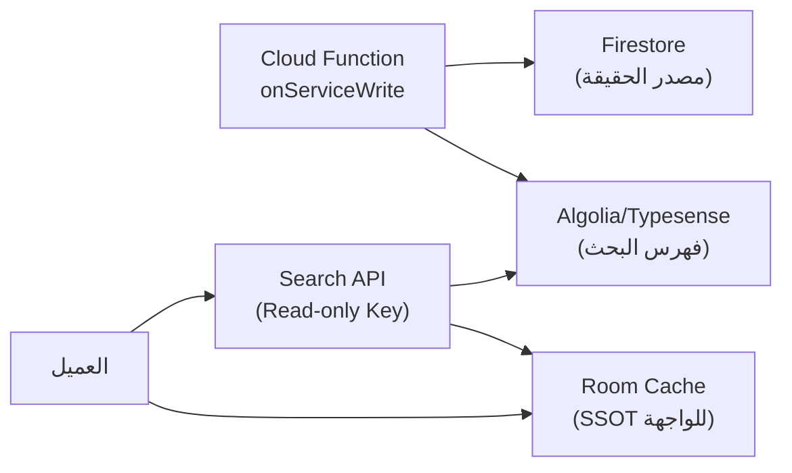

# قابلية التوسع (Scalability Guide)

> [!IMPORTANT]
> هذا الملف يوثق القرارات المعمارية التي تُتخذ **اليوم** لتسهيل التوسع **غداً**. كل قاعدة هنا توفر أسابيع من إعادة الهيكلة لاحقاً.

## 1. التوسع في الميزات (Feature Scalability)

### 1.1 نظام الموديولات الهجين (الطبقات داخل الميزات — Layers inside Features)

> المرجع: [ADR-0007](adr/0007-hybrid-feature-modularization.md)

يجمع مشروع **صِلَة** بين **التقسيم حسب الميزة على مستوى الموديولات** و**التقسيم حسب الطبقات (Clean Architecture) داخل كل ميزة**:

```text
إضافة ميزة جديدة "X" في 3 خطوات معزولة تماماً:
1. أنشئ موديول :feature:x وبداخله الحزم الثلاث:
   ├── app.sila.feature.x.domain        ← UseCases + Repository interface
   ├── app.sila.feature.x.data          ← RepositoryImpl (يتعامل مع :core:database)
   └── app.sila.feature.x.presentation  ← ViewModel + UiState + Intent + Effect
2. سجّل تبعيات الميزة في :sharedLogic (KoinModule)
3. أضف شاشة الواجهة في :sharedUI (Compose) و iosApp/Features/X/ (SwiftUI)

لا تعديل على أي ميزة موجودة (:feature:contacts أو :feature:arham أو :feature:services).
```

#### مقارنة استراتيجية التقسيم المعتمدة:
| وجه المقارنة | الطبقات داخل الميزات (المعتمد في صِلَة ✅) | الميزات داخل الطبقات (مرفوض ❌) |
|---|---|---|
| **سهولة العمل والتطوير** | عالية جداً — الميزة مكتفية ذاتياً في مجلد واحد | متوسطة — تتطلب التنقل بين 3 موديولات لكل تعديل |
| **وقت البناء (Build Time)** | سريع جداً — تعديل ميزة يعيد بناء موديولها فقط | أبطأ — أي تعديل يعيد بناء طبقة كاملة |
| **حماية الخصوصية (Privacy)** | مضمونة بالمترجم — `:feature:contacts` و `:feature:arham` لا يملكان تبعية للشبكة | أصعب في العزل داخل طبقة `data` مشتركة |
| **استقلالية الميزات** | الميزات لا تعتمد على بعضها؛ تتشارك عبر `:core:database` و `:core:model` فقط | الطبقات تعتمد على بعضها عمودياً |

### 1.2 Convention Plugins — لا تكرار في Gradle
```text
build-logic/
  convention/
    src/main/kotlin/
      SilaKmpLibraryPlugin.kt      ← يُطبق على كل shared module
      SilaAndroidAppPlugin.kt      ← يُطبق على androidApp/app
      SilaAndroidFeaturePlugin.kt   ← يُطبق على كل androidApp/feature/*/ui
      SilaComposePlugin.kt          ← Compose compiler + BOM
      SilaRoomPlugin.kt             ← Room + KSP + schema export
```
- **إضافة موديول جديد:** سطر واحد في `build.gradle.kts`:
  ```kotlin
  plugins { id("sila.kmp.library") }
  ```
- **تحديث مكتبة:** تغيير مكان واحد في `libs.versions.toml`.
- **إضافة قاعدة بناء:** مكان واحد في Convention Plugin.

### 1.3 Feature Flags — تفعيل تدريجي
```kotlin
// في core:common
interface FeatureFlags {
    val isProDashboardEnabled: Boolean
    val isAlgoliaSearchEnabled: Boolean
    val isFamilyTreeV2Enabled: Boolean
    // ...
}

// التنفيذ: Remote Config (سحابي) مع قيم افتراضية مضمّنة (Offline)
```
- كل ميزة جديدة تُغلف بـ `if (featureFlags.isXEnabled)`.
- الإطلاق التدريجي: 1% → 10% → 50% → 100%.
- التراجع الفوري: تعطيل من Firebase Console بدون تحديث.

### 1.4 Deep Links — نمط موحد قابل للتمديد
```text
المخطط الحالي:
  sila://contact/{id}
  sila://service/{serviceId}
  sila://arham
  https://sila.app/s/{serviceId}
  https://sila.app/p/{cardId}

القاعدة: كل شاشة جديدة تحصل على route + deep link.
التنفيذ: Navigation Compose type-safe routes → تُربط بـ intent-filter / Universal Links.
```

## 2. التوسع في البيانات (Data Scalability)

### 2.1 Room Migrations — لا فقدان بيانات أبداً
```kotlin
// ✅ صحيح — Migration صريحة
val MIGRATION_3_4 = object : Migration(3, 4) {
    override fun migrate(db: SupportSQLiteDatabase) {
        db.execSQL("ALTER TABLE contacts ADD COLUMN linkedServiceCloudId TEXT")
    }
}

// ❌ ممنوع في الإنتاج
fallbackToDestructiveMigration()
```
- **كل Migration لها اختبار** (`MigrationTestHelper`).
- **Schema export** مُفعّل — ملفات JSON في `schemas/`.
- **Backward compatibility:** التطبيق القديم لا ينهار إن فتح قاعدة بيانات أحدث (الأعمدة الإضافية تُتجاهل).

### 2.2 Firestore — هيكل مُسطح قابل للنمو
```text
القاعدة الذهبية:
  - لا تداخل (nesting) أعمق من مستويين.
  - كل مجموعة فرعية لها مستند أب محدد.
  - الحقول المحسوبة (trustScore, visibility) تُكتب عبر Functions فقط.
  - الفهارس تُضاف لكل استعلام جديد.

التوسع المستقبلي:
  users/{uid}/preferences/        ← بدلاً من حقول في users
  services/{id}/reviews/          ← تقييمات مفصلة (Pro V2)
  services/{id}/media/            ← صور الأعمال (Pro)
  chats/{chatId}/messages/        ← إن أضيفت المراسلة لاحقاً
```

### 2.3 Paging في كل مكان
```kotlin
// القاعدة: أي قائمة قد تتجاوز 50 عنصراً = PagingSource
@Query("SELECT * FROM contacts WHERE category = :cat ORDER BY displayName")
fun pagingSource(cat: Category): PagingSource<Int, ContactEntity>

// Firestore: limit(30) + startAfter(lastDoc) + Cache في Room
```

### 2.4 مخطط الإصدارات (Versioned Schema)
```kotlin
// كل DTO من السحابة يحمل إصدار
@Serializable
data class ServiceDto(
    val version: Int = 1,    // ← يتجاهل العميل القديم الحقول الجديدة
    // ...
)
```

## 3. التوسع في المنصات (Platform Scalability)

### 3.1 حدود المنصات — واجهات لا `expect/actual`

> المرجع: [ADR-0009](adr/0009-contacts-platform-boundary.md) — يستبدل المخطط التالي.

```kotlin
// في :feature:contacts:domain — بلا أي أنواع منصة
interface ContactsPlatformSource {
    suspend fun readAll(): List<PlatformContact>              // الترقيم داخل التنفيذ
    fun observeChanges(): Flow<ContactsChangeSignal>          // إشارة "قذرة" فقط
    suspend fun readDelta(snapshot: SyncSnapshot): ContactsDelta
}
// في :feature:contacts:data — AndroidContactsPlatformSource / IosContactsPlatformSource، تربطها Koin
```
- **إضافة منصة جديدة (Web/Desktop):** تنفيذ جديد للواجهة فقط — لا تعديل على المنطق المشترك.
- **Interfaces بدلاً من abstract classes** — لمرونة التنفيذ والاستبدال في الاختبارات.
- **`expect/actual` محصور في الغراء النظامي** (`ContentResolver` / `CNContactStore`) وليس في عقود المصادر.
- كتابة دفتر الهاتف (إضافة/تعديل/حذف) بعقد منفصل `ContactsPlatformWriter` — لا تخلطها مع المزامنة.

### 3.2 Design System — مكوّنات مركزية
```text
القاعدة:
  - لا لون/حجم/خط ثابت في أي شاشة — كلها من SilaTheme.
  - كل مكوّن (ActionSheet, Chip, StatCard...) مركزي في core:designsystem.
  - تغيير اللون الأساسي = تغيير مكان واحد.
  - إضافة theme جديد (مثل: high contrast) = ColorScheme جديد فقط.
```

### 3.3 الترجمة — جاهزة لأي لغة
```text
القاعدة:
  - لا نصوص ثابتة في الكود — أبداً.
  - مفاتيح وصفية: arham_status_overdue_days وليس string_42.
  - Plurals: العربية تحتاج 6 صيغ (zero/one/two/few/many/other).
  - أرقام الهاتف دائماً LTR حتى في RTL.
  
التوسع:
  - إضافة لغة = ملف ترجمة واحد (strings.xml / Localizable.xcstrings).
  - لا تعديل على الكود.
```

## 4. التوسع في الفريق (Team Scalability)

### 4.1 ملكية الموديولات (Code Ownership)
```text
# مثال CODEOWNERS (مستقبلي)
shared/domain/arham/     @team-arham
shared/domain/services/  @team-services
shared/core/database/    @team-platform
androidApp/              @team-android
iosApp/                  @team-ios
```

### 4.2 بناء تزايدي (Incremental Builds)
- كل موديول يُبنى مستقلاً — تغيير في `feature:arham` لا يعيد بناء `feature:contacts`.
- **Gradle Build Cache** مُفعّل + Remote Cache (في CI).
- **Configuration Cache** مُفعّل.
- **بناء كامل (Clean build):** هدف ≤ 3 دقائق على CI.

### 4.3 التوثيق الذاتي
- كل UseCase له KDoc مختصر.
- كل ViewModel يصف `UiState` و `Intent` و `Effect`.
- كل ADR يوثق: السياق، الخيارات، القرار، العواقب.
- `CHANGELOG.md` يُحدّث مع كل PR.

## 5. التوسع في البنية التحتية (Infrastructure Scalability)

### 5.1 Firebase — خطة النمو
| المرحلة | المستخدمون | الخطة | الاحتياطات |
|---|---|---|---|
| MVP | 0 – 1K | Spark (مجاني) → Blaze | Rate limits واسعة |
| نمو | 1K – 50K | Blaze | مراقبة التكلفة + Billing Alerts |
| توسع | 50K+ | Blaze + CDN + Algolia | Firestore sharding إن لزم |

### 5.2 Firestore Cost Controls
```text
القواعد الذهبية:
  1. لا تقرأ مستنداً إلا عند الحاجة — استخدم Cache Room + syncedAt.
  2. limit() في كل استعلام — لا scrolling بلا حدود.
  3. اجمع Impressions محلياً وأرسلها Batched (كل 4 ساعات).
  4. الضيوف يقرؤون = استخدم Pagination + Cache محلي.
  5. لا listener على مجموعة كاملة — استخدم FCM Topics للتحديثات.
```

### 5.3 البحث — خطة الترقية
```text
المرحلة 1-2: FTS في Room (محلي) + Firestore queries مع Geohash (سحابي)
المرحلة 3:  إن تجاوزت الخدمات 10K: Algolia أو Typesense
            - الفهرس يُملأ من Cloud Function عند كل كتابة
            - العميل يستعلم مباشرة (Read-only API Key)
            - Room يبقى SSOT — النتائج تُحفظ فيه
```

### 5.4 خطة الانتقال لـ Algolia/Typesense — المحفزات والآلية

> [!NOTE]
> الانتقال ليس ضرورياً في البداية — Firestore + Geohash كافٍ حتى ~10K خدمة.

**محفزات الانتقال (أي واحد يكفي):**
| المحفز | العتبة | طريقة القياس |
|---|---|---|
| عدد مستندات `services` | > **10,000** | Firestore Dashboard |
| زمن استجابة البحث (P95) | > **800ms** | Firebase Performance Monitoring |
| تكلفة القراءات الشهرية | > **\$5/شهر** على البحث وحده | Billing Alerts |
| شكاوى المستخدمين | > 5% يبلغون عن "بطء البحث" | Analytics `directory_search` مع `results_count == 0` |

**آلية التعايش (Hybrid):**


- **المرحلة الانتقالية:** Feature Flag `search_provider = "firestore" | "algolia"` في Remote Config.
- **التكلفة:** Algolia مجاني حتى 10K records + 10K searches/شهر. Typesense مفتوح المصدر (مجاني ذاتي الاستضافة).
- **Rollback:** إن فشل Algolia — الـ Flag يعيد البحث لـ Firestore فوراً.

## 6. قائمة التحقق — "هل هذا القرار قابل للتوسع؟"

> [!TIP]
> قبل كل قرار تصميمي أو تقني، اسأل هذه الأسئلة:

- [ ] هل يمكنني إضافة ميزة مشابهة بدون تعديل الكود الموجود؟ (Open/Closed)
- [ ] هل يمكنني تغيير المكتبة الخارجية بدون تعديل الـ domain؟ (Dependency Inversion)
- [ ] هل يمكنني اختبار هذا الكود بدون جهاز فعلي أو إنترنت؟ (Testability)
- [ ] هل يعمل هذا مع 10,000 جهة اتصال كما يعمل مع 100؟ (Data Scalability)
- [ ] هل يمكن لمطور جديد فهم هذا الموديول بدون قراءة كل الكود؟ (Readability)
- [ ] هل يمكنني تعطيل هذه الميزة بضغطة زر في Remote Config؟ (Feature Flags)
- [ ] هل Migration واضحة ومختبرة إن تغير الـ Schema؟ (Data Migration)
